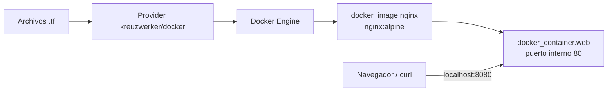

# Laboratorio 01 — Terraform + Docker (Nginx local)

> Navegación: [README general](../README.md) · ← anterior: ninguno (empezás acá) · siguiente: [Laboratorio 02 — MiniStack](../02-terraform-aws-ministack/README.md) →

Este laboratorio es el **recomendado para empezar**. Corre 100 % en tu máquina, no usa la nube y no tiene costo.

## Objetivo

Crear un servidor web Nginx accesible en <http://localhost:8080> **con Terraform**, en lugar de usar `docker run`. Al terminar vas a poder explicar el ciclo `init → fmt → validate → plan → apply → destroy`, qué es el state y cómo Terraform detecta cambios.

## Qué vas a construir



Terraform administra **2 recursos**: la imagen (`docker_image.nginx`) y el contenedor (`docker_container.web`). El contenedor depende de la imagen porque usa `docker_image.nginx.image_id`.

## Prerrequisitos

| ✔ | Requisito | Cómo verificarlo | Resultado esperado |
|---|---|---|---|
| [ ] | Terraform CLI `>= 1.5.0` | `terraform version` | `Terraform v1.5.0` o superior |
| [ ] | Docker Engine o Docker Desktop **encendido** | `docker info` | Muestra `Server:` sin errores |
| [ ] | Puerto 8080 libre | `curl -I http://localhost:8080` | Debe **fallar** (nadie escucha todavía) |
| [ ] | Internet (primera vez) | — | `terraform init` descarga el provider y Docker la imagen |

Si `docker info` falla, resolvé Docker antes de seguir: Terraform no puede crear nada sin él.

## Archivos del laboratorio

| Archivo | Para qué sirve |
|---|---|
| `versions.tf` | Versión mínima de Terraform (`>= 1.5.0`) y provider `kreuzwerker/docker ~> 4.2.0` |
| `providers.tf` | Conexión con el Docker Engine local (`provider "docker" {}`) |
| `main.tf` | Recursos: imagen `docker_image.nginx` y contenedor `docker_container.web` |
| `variables.tf` | Variables de entrada con valores por defecto y validación del puerto |
| `outputs.tf` | Salidas: URL de la app y nombre del contenedor |
| `terraform.tfvars.example` | Plantilla de valores. La copiás a `terraform.tfvars` (ignorado por Git) |
| `.terraform.lock.hcl` | Versiones exactas de providers. Se versiona, no lo borres |

## Variables y outputs

| Variable | Tipo | Default | Descripción |
|---|---|---|---|
| `container_name` | `string` | `"web-terraform"` | Nombre del contenedor |
| `image_name` | `string` | `"nginx:alpine"` | Imagen Docker a ejecutar |
| `external_port` | `number` | `8080` | Puerto publicado en tu máquina. Validación: entre 1024 y 65535 |

| Output | Qué muestra |
|---|---|
| `url_web` | URL de la aplicación, por ejemplo `http://localhost:8080` |
| `container_name` | Nombre final del contenedor creado |

## Paso a paso

Todos los comandos se ejecutan **desde la carpeta del laboratorio**.

1. Verificá las herramientas.

   ```bash
   terraform version
   docker info
   ```

   Salida esperada: la versión de Terraform y la información del servidor Docker, sin `Cannot connect to the Docker daemon`.

2. Entrá a la carpeta y creá tu archivo de variables.

   ```bash
   cd 01-terraform-docker
   cp terraform.tfvars.example terraform.tfvars
   ```

   En Windows PowerShell: `Copy-Item terraform.tfvars.example terraform.tfvars`.

3. Inicializá el directorio (descarga el provider Docker).

   ```bash
   terraform init
   ```

   Salida esperada: `Terraform has been successfully initialized!`

4. Formateá y validá.

   ```bash
   terraform fmt
   terraform validate
   ```

   Salida esperada: `fmt` no imprime nada si ya estaba formateado; `validate` imprime `Success! The configuration is valid.`

5. Revisá el plan **antes** de aplicar.

   ```bash
   terraform plan
   ```

   Salida esperada: dos recursos con `+` (crear) y al final `Plan: 2 to add, 0 to change, 0 to destroy.`

6. Aplicá y confirmá escribiendo `yes`.

   ```bash
   terraform apply
   ```

   Salida esperada:

   ```text
   Apply complete! Resources: 2 added, 0 changed, 0 destroyed.

   Outputs:

   container_name = "web-terraform"
   url_web = "http://localhost:8080"
   ```

## Verificación

```bash
curl -I http://localhost:8080
docker ps
terraform output
terraform state list
```

Salidas esperadas:

- `curl -I` responde `HTTP/1.1 200 OK` (también podés abrir <http://localhost:8080> y ver la página de bienvenida de Nginx).
- `docker ps` lista el contenedor `web-terraform` con `0.0.0.0:8080->80/tcp`.
- `terraform output` muestra `container_name` y `url_web`.
- `terraform state list` muestra exactamente:

  ```text
  docker_container.web
  docker_image.nginx
  ```

## Ejercicios opcionales

1. **Cambio de puerto (reemplazo).** En `terraform.tfvars` poné `external_port = 8081` y ejecutá:

   ```bash
   terraform plan
   ```

   Salida esperada: el contenedor aparece con `-/+` (destruir y volver a crear) y `Plan: 1 to add, 0 to change, 1 to destroy.` El provider no puede cambiar el puerto publicado de un contenedor existente, por eso lo **reemplaza**. Aplicá con `terraform apply` y verificá con `curl -I http://localhost:8081`.

2. **Drift (cambio por fuera de Terraform).** Borrá el contenedor a mano y pedile un plan a Terraform:

   ```bash
   docker rm -f web-terraform
   terraform plan
   ```

   Salida esperada: Terraform detecta que el contenedor ya no existe y propone volver a crearlo (`1 to add`). Ejecutá `terraform apply` para volver al estado declarado. Esto es *drift*: la realidad se apartó de lo que dice el código y el state.

3. **Validación.** Poné `external_port = 80` y corré `terraform plan`. Salida esperada: error `El puerto debe estar entre 1024 y 65535.` Volvé a `8080`.

## Limpieza

```bash
terraform plan -destroy
terraform destroy
docker ps -a
```

Confirmá con `yes`. Salida esperada: `Destroy complete! Resources: 2 destroyed.` y `docker ps -a` ya no muestra `web-terraform`.

Alternativa desde la raíz del repo (hace el destroy y borra los archivos generados, como `.terraform/`):

```bash
cd ..
./cleanup.sh --lab 01
```

## Problemas comunes

| Síntoma | Causa | Solución |
|---|---|---|
| `Cannot connect to the Docker daemon` | Docker apagado o el provider no encuentra el socket | Encendé Docker y verificá con `docker info`. En macOS con Docker Desktop, si persiste: `export DOCKER_HOST=unix://$HOME/.docker/run/docker.sock` |
| Error de conexión en Windows con Docker Desktop | El provider necesita el named pipe | En `providers.tf` probá `provider "docker" { host = "npipe:////.//pipe//docker_engine" }` (como en el tutorial oficial de HashiCorp) |
| `port is already allocated` | Otro proceso usa el puerto 8080 | Liberá el puerto o cambiá `external_port` en `terraform.tfvars` (por ejemplo `8081`) |
| `Conflict. The container name "/web-terraform" is already in use` | Ya existe un contenedor con ese nombre creado a mano o en otra práctica | Borralo con `docker rm -f web-terraform` o cambiá `container_name` |
| `El puerto debe estar entre 1024 y 65535.` | `external_port` fuera de rango | Usá un puerto entre 1024 y 65535 |
| `terraform: command not found` | Terraform no está en el `PATH` | Instalalo y verificá con `terraform version` |

El provider se probó con la versión `4.2.x` usada en el tutorial de HashiCorp (`~> 4.2.0` en `versions.tf`).

## Preguntas de repaso

1. **¿Qué crea Terraform?** Una imagen administrada (`docker_image.nginx`) y un contenedor (`docker_container.web`).
2. **¿Por qué existe una dependencia?** Porque `docker_container.web` usa `docker_image.nginx.image_id`; Terraform crea primero la imagen.
3. **¿Qué hace `terraform plan`?** Compara la configuración, el state y la infraestructura real, y propone acciones sin ejecutarlas.
4. **¿Dónde se guardan los recursos administrados?** En `terraform.tfstate`, local en esta práctica. No se sube a Git (ya está en `.gitignore`).
5. **¿Por qué cambiar el puerto recrea el contenedor?** Porque el puerto publicado no se puede modificar en caliente: el provider marca el contenedor para reemplazo (`-/+`).
