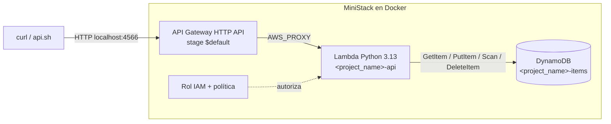

# Laboratorio 02 — API AWS en MiniStack (emulador local)

> Navegación: [README general](../README.md) · ← anterior: [Laboratorio 01 — Docker](../01-terraform-docker/README.md) · siguiente: [Laboratorio 03 — AWS real](../03-terraform-aws-real/README.md) →

Lab **local con AWS emulado**. Todo se despliega contra **MiniStack**, un emulador de AWS que corre en un contenedor Docker en tu máquina: no usa tu cuenta de AWS y no tiene costo.

> **Estado:** este laboratorio no fue validado end-to-end contra un MiniStack en ejecución. Si la API no responde en tu versión del emulador, el aprendizaje sigue siendo el `plan` y la arquitectura: leé qué crea Terraform y por qué.

## Objetivo

Desplegar con Terraform una API de productos (API Gateway HTTP API → Lambda en Python → DynamoDB, con permisos IAM) contra un emulador local, y probarla con `api.sh`. Es la misma infraestructura del laboratorio 03, pero sin riesgos ni costos.

## Qué vas a construir



Rutas de la API: `PUT /items`, `GET /items`, `GET /items/{id}`, `DELETE /items/{id}`.

Terraform administra **13 recursos**: tabla DynamoDB, rol IAM, política inline, attachment de la política de logs, función Lambda, API, integración, 4 rutas, stage `$default` y permiso para que API Gateway invoque a la Lambda.

### Diferencias con AWS real (lab 03)

| Aspecto | Lab 02 (MiniStack) | Lab 03 (AWS real) |
|---|---|---|
| `providers.tf` | Endpoints en `var.ministack_endpoint` (`http://localhost:4566`) y credenciales **ficticias** `test` | Provider estándar, credenciales de tu entorno |
| Costo | Ninguno | Puede generar costos |
| URL de la API | El output `api_url` normalmente **no** es invocable desde tu máquina; se usa `api_id` | `api_url` es una URL pública HTTPS |
| Rol IAM | Siempre lo crea Terraform | Podés reutilizar uno existente (`lambda_role_arn`) |
| State | `02-terraform-aws-ministack/terraform.tfstate` | `03-terraform-aws-real/terraform.tfstate` (otro directorio, otro state) |

## Prerrequisitos

| ✔ | Requisito | Cómo verificarlo | Resultado esperado |
|---|---|---|---|
| [ ] | Laboratorio 01 terminado | — | Entendés `plan`/`apply`/`destroy` |
| [ ] | Terraform CLI `>= 1.5.0` | `terraform version` | `Terraform v1.5.0` o superior |
| [ ] | Docker encendido | `docker info` | Sin errores |
| [ ] | MiniStack corriendo en el puerto 4566 | `curl http://localhost:4566/_ministack/health` | Respuesta HTTP 200 (ver paso 1) |
| [ ] | `curl` y bash | `curl --version` · `bash --version` | En Windows: WSL2 o Git Bash |
| [ ] | AWS CLI v2 (opcional) | `aws --version` | Solo para la verificación alternativa |

Las credenciales `test` de `providers.tf` son ficticias: MiniStack no valida credenciales, así que **no necesitás** una cuenta de AWS.

## Archivos del laboratorio

| Archivo | Para qué sirve |
|---|---|
| `versions.tf` | Terraform `>= 1.5.0`, providers `hashicorp/aws ~> 6.0` y `hashicorp/archive ~> 2.0` |
| `providers.tf` | Provider AWS apuntado a MiniStack (endpoints locales, credenciales `test`) |
| `main.tf` | Infraestructura: DynamoDB, IAM, Lambda, API Gateway (bloques explícitos, sin módulos) |
| `variables.tf` | `aws_region`, `project_name`, `ministack_endpoint` |
| `outputs.tf` | `api_url`, `api_id`, `table_name`, `lambda_name` |
| `lambda/index.py` | Código de la Lambda (CRUD de productos; serializa `Decimal` con `json_default`) |
| `api.sh` | Prueba la API (CRUD completo) o carga datos de ejemplo; arma la URL local desde `api_id` |
| `terraform.tfvars.example` | Plantilla de valores. La copiás a `terraform.tfvars` (ignorado por Git) |
| `.terraform.lock.hcl` | Versiones exactas de providers. Se versiona |

`lambda.zip` lo genera `archive_file` durante `plan`/`apply` y está ignorado por Git.

## Variables y outputs

| Variable | Tipo | Default | Descripción |
|---|---|---|---|
| `aws_region` | `string` | `"us-east-1"` | Región usada por MiniStack |
| `project_name` | `string` | `"tf-labs-demo01"` | Prefijo único para los nombres de todos los recursos |
| `ministack_endpoint` | `string` | `"http://localhost:4566"` | Endpoint local del emulador |

| Output | Qué muestra |
|---|---|
| `api_url` | URL que reporta API Gateway (en MiniStack puede no ser accesible desde el host) |
| `api_id` | ID de la API; con él se arma la URL de invocación local |
| `table_name` | Nombre de la tabla: `<project_name>-items` |
| `lambda_name` | Nombre de la función: `<project_name>-api` |

## Paso a paso

Desde la raíz del repositorio:

1. Levantá MiniStack y verificá que esté sano.

   ```bash
   docker run -d --name ministack -p 4566:4566 ministackorg/ministack
   curl http://localhost:4566/_ministack/health
   ```

   Salida esperada: el `docker run` imprime el ID del contenedor y el `curl` responde con el estado del emulador (HTTP 200). Si el `curl` falla, esperá unos segundos y repetilo. Si ya lo tenías creado, usá `docker start ministack`.

2. Entrá a la carpeta y creá tu archivo de variables.

   ```bash
   cd 02-terraform-aws-ministack
   cp terraform.tfvars.example terraform.tfvars
   ```

   Editá `project_name` con tu identificador y confirmá que `ministack_endpoint` sea `http://localhost:4566`.

3. Inicializá, formateá y validá.

   ```bash
   terraform init
   terraform fmt
   terraform validate
   ```

   Salida esperada: `Terraform has been successfully initialized!` y `Success! The configuration is valid.`

4. Revisá el plan.

   ```bash
   terraform plan
   ```

   Salida esperada: `Plan: 13 to add, 0 to change, 0 to destroy.` Buscá en el plan la tabla, el rol, la Lambda, la API, las 4 rutas y el permiso.

5. Aplicá y confirmá con `yes`.

   ```bash
   terraform apply
   terraform output
   ```

   Salida esperada: `Apply complete! Resources: 13 added, 0 changed, 0 destroyed.` y los outputs `api_id`, `api_url`, `lambda_name` (`<project_name>-api`) y `table_name` (`<project_name>-items`).

## Verificación

Con `api.sh` (desde la carpeta del lab; el primer argumento vacío `""` hace que arme la URL sola a partir de `terraform output -raw api_id`):

```bash
./api.sh "" test
```

Salida esperada: 7 casos `[OK ]` (crear, listar, leer, id inexistente → 404, PUT inválido → 400, eliminar, leer tras eliminar → 404) y al final `Resultado: TODO OK`.

Para cargar productos de ejemplo:

```bash
./api.sh "" cargar
```

Si preferís `curl` a mano, la URL de invocación local es:

```bash
API_URL="http://localhost:4566/_aws/execute-api/$(terraform output -raw api_id)"
curl -i -X PUT "$API_URL/items" -H 'Content-Type: application/json' -d '{"id":"101","name":"Teclado","price":150}'
curl -i "$API_URL/items"
curl -i "$API_URL/items/101"
curl -i -X DELETE "$API_URL/items/101"
```

`api.sh` prueba también otros formatos de URL (con stage, por subdominio `http://<api_id>.execute-api.localhost:4566`) y usa el primero que responda 200 en `GET /items`. Si ninguno responde, avisa con `AVISO: ningún formato de URL respondió 200...`.

Verificación alternativa con AWS CLI (credenciales ficticias, solo para el emulador):

```bash
export AWS_ACCESS_KEY_ID=test AWS_SECRET_ACCESS_KEY=test AWS_REGION=us-east-1
aws --endpoint-url=http://localhost:4566 dynamodb scan --table-name "$(terraform output -raw table_name)"
aws --endpoint-url=http://localhost:4566 lambda list-functions --query "Functions[].FunctionName"
```

## Ejercicios opcionales

1. **Leer el plan.** Antes de aplicar, identificá en `terraform plan` qué recurso usa `aws_dynamodb_table.items.name` y por qué la Lambda se crea después de la tabla.
2. **Cambio de nombre.** Cambiá `project_name` en `terraform.tfvars` y corré `terraform plan`. ¿Qué recursos se reemplazan (`-/+`) y por qué?
3. **Nuevo endpoint (en papel).** Diseñá un `GET /health`: ¿qué recurso `aws_apigatewayv2_route` agregarías y qué cambiaría en `lambda/index.py`? No hace falta desplegarlo.

## Limpieza

```bash
terraform plan -destroy
terraform destroy
```

Confirmá con `yes`. Salida esperada: `Destroy complete! Resources: 13 destroyed.`

Alternativa desde la raíz del repo (verifica que MiniStack responda, hace el destroy y borra `.terraform/` y `lambda.zip`):

```bash
cd ..
./cleanup.sh --lab 02
```

Opcional, para apagar el emulador (ni `terraform destroy` ni `cleanup.sh` lo hacen):

```bash
docker rm -f ministack
```

Si borrás MiniStack **antes** del destroy, su contenido se pierde pero tu `terraform.tfstate` sigue listando los recursos. En ese caso volvé a levantarlo (paso 1) y corré `terraform destroy`: al refrescar, Terraform normalmente detecta que los recursos ya no existen y deja el state vacío.

## Problemas comunes

| Síntoma | Causa | Solución |
|---|---|---|
| `connection refused` en `localhost:4566` durante `plan`/`apply` | MiniStack no está corriendo | `docker ps`; levantalo con el paso 1 y verificá `/_ministack/health` |
| `Bind for 0.0.0.0:4566 failed: port is already allocated` | Otro emulador (por ejemplo LocalStack) usa el puerto | Apagá el otro contenedor o cambiá el puerto y `ministack_endpoint` |
| `Conflict. The container name "/ministack" is already in use` | El contenedor ya existe | `docker start ministack` o `docker rm -f ministack` y volvé a crearlo |
| `api.sh` muestra `AVISO: ningún formato de URL respondió 200...` | La API o la Lambda no responden en tu versión de MiniStack | Revisá `terraform output`, probá la URL manual y la verificación con AWS CLI. Si no hay forma, quedate con el plan y la arquitectura |
| `ERROR: no se pudo determinar la URL de la API.` | Ejecutaste `api.sh` fuera de la carpeta del lab o sin `apply` | Corré `./api.sh` desde `02-terraform-aws-ministack/` después de `terraform apply` |
| `curl "$(terraform output -raw api_url)/items"` no responde | En MiniStack la URL del output no es invocable desde el host | Usá `./api.sh` o la URL `http://localhost:4566/_aws/execute-api/<api_id>` |
| Error de un servicio no soportado | El emulador no implementa ese recurso u opción | Anotá el error; el objetivo es entender el plan |

## Preguntas de repaso

1. **¿Qué hace cada servicio?** API Gateway recibe y enruta la petición, Lambda ejecuta la lógica y DynamoDB guarda los productos.
2. **¿Por qué hace falta `aws_lambda_permission`?** Porque API Gateway necesita autorización explícita para invocar a la Lambda.
3. **¿Cómo sabe la Lambda el nombre de la tabla?** Por la variable de entorno `TABLE_NAME = aws_dynamodb_table.items.name`, que además crea la dependencia.
4. **¿Por qué las credenciales `test` no son un problema de seguridad?** Porque son ficticias y solo valen para el emulador local.
5. **¿Por qué el lab 02 y el 03 están en carpetas distintas?** Para que cada uno tenga su propio state: mezclar MiniStack y AWS real en un mismo state puede destruir o modificar recursos equivocados.
