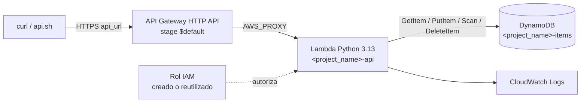

# Laboratorio 03 — API en AWS real (opcional)

> Navegación: [README general](../README.md) · ← anterior: [Laboratorio 02 — MiniStack](../02-terraform-aws-ministack/README.md) · siguiente: ninguno (último lab) →

> ⚠️ **Advertencia — leé esto antes de empezar.**
>
> - Este laboratorio crea recursos **reales** en AWS y **puede generar costos**.
> - La API queda **pública y sin autenticación**: cualquiera con la URL puede leer, crear y borrar productos.
> - Usá **solo** una cuenta de práctica autorizada (sandbox autorizada), nunca una cuenta corporativa ni una personal sin control de costos. Preferí credenciales temporales.
> - **Destruí todo al terminar** (sección [Limpieza](#limpieza)) y verificá que no quede nada.

## Objetivo

Desplegar en AWS la misma API del laboratorio 02 (API Gateway HTTP API → Lambda → DynamoDB, con IAM), probarla con una URL pública y destruirla de forma controlada, entendiendo credenciales, región y permisos IAM.

## Qué vas a construir



Rutas: `PUT /items`, `GET /items`, `GET /items/{id}`, `DELETE /items/{id}`.

Recursos que administra Terraform:

- Con `lambda_role_arn = ""` (Terraform crea el rol): **13 recursos**.
- Con `lambda_role_arn` = ARN de un rol existente: **10 recursos** (no crea el rol, ni la política inline, ni el attachment de logs).

## Prerrequisitos

| ✔ | Requisito | Cómo verificarlo | Resultado esperado |
|---|---|---|---|
| [ ] | Laboratorios 01 y 02 entendidos | — | Sabés leer un plan |
| [ ] | Terraform CLI `>= 1.5.0` | `terraform version` | `Terraform v1.5.0` o superior |
| [ ] | AWS CLI v2 | `aws --version` | `aws-cli/2.x` |
| [ ] | `curl` y bash | `curl --version` · `bash --version` | En Windows: WSL2 o Git Bash |
| [ ] | Cuenta AWS de práctica autorizada | `aws sts get-caller-identity` (ver [Credenciales](#credenciales)) | Devuelve tu `Account` y `Arn` |
| [ ] | Permisos sobre DynamoDB, Lambda, API Gateway e IAM | Ver [¿Podés crear roles IAM?](#podés-crear-roles-iam) | — |

## Archivos del laboratorio

| Archivo | Para qué sirve |
|---|---|
| `versions.tf` | Terraform `>= 1.5.0`, providers `hashicorp/aws ~> 6.0` y `hashicorp/archive ~> 2.0` |
| `providers.tf` | Provider AWS estándar: toma las credenciales del entorno (nunca escritas en `.tf`) |
| `main.tf` | Infraestructura; el rol IAM se crea solo si `lambda_role_arn` está vacío |
| `variables.tf` | `aws_region`, `project_name` (con validación), `lambda_role_arn` |
| `outputs.tf` | `api_url`, `api_id`, `table_name`, `lambda_name` |
| `lambda/index.py` | Código de la Lambda (idéntico al del lab 02) |
| `api.sh` | Prueba la API (CRUD completo) o carga datos; toma la URL de `terraform output -raw api_url` |
| `terraform.tfvars.example` | Plantilla de valores. La copiás a `terraform.tfvars` (ignorado por Git) |
| `aws-credentials.sh.example` | Plantilla de credenciales. La copiás a `aws-credentials.sh` (ignorado por Git) y la cargás con `source` |
| `iam-examples/` | Trust policy y permissions policy de referencia para el rol de la Lambda ([README](iam-examples/README.md)) |
| `.terraform.lock.hcl` | Versiones exactas de providers. Se versiona |

## Variables y outputs

| Variable | Tipo | Default | Descripción |
|---|---|---|---|
| `aws_region` | `string` | `"us-east-1"` | Región donde se crean los servicios. Tiene que coincidir con `AWS_REGION` |
| `project_name` | `string` | `"tf-labs-demo01"` | Prefijo de los recursos. Validación: `^[a-z][a-z0-9-]{2,35}$` (3 a 36 caracteres, empieza con minúscula) |
| `lambda_role_arn` | `string` | `""` | Vacío = Terraform crea el rol. Con valor = reutiliza ese rol existente |

| Output | Qué muestra |
|---|---|
| `api_url` | URL pública HTTPS de la API (`https://<api_id>.execute-api.<region>.amazonaws.com`) |
| `api_id` | ID de la API Gateway |
| `table_name` | Nombre de la tabla: `<project_name>-items` |
| `lambda_name` | Nombre de la función: `<project_name>-api` |

## Paso a paso

Partís de la raíz del repo; desde el paso 1 todos los comandos se ejecutan en `03-terraform-aws-real/` y **en la misma terminal** (las credenciales viven en las variables de entorno de esa terminal).

### Credenciales

1. Creá tu archivo de credenciales a partir de la plantilla y completalo con los datos que te da el sandbox o la consola.

   ```bash
   cd 03-terraform-aws-real
   cp aws-credentials.sh.example aws-credentials.sh
   ```

   Reemplazá `<TU_ACCESS_KEY_ID>` y `<TU_SECRET_ACCESS_KEY>`. Si tus credenciales son **temporales** (la access key empieza con `ASIA`, típico de sandboxes, AWS SSO o STS/AssumeRole), descomentá también `export AWS_SESSION_TOKEN="<TU_SESSION_TOKEN>"` y completalo. Si son permanentes de un usuario IAM (`AKIA...`), dejá esa línea comentada.

2. Cargalo con `source` (no con `./`: un proceso hijo no deja las variables en tu terminal; la plantilla aborta con `Usá: source aws-credentials.sh` si lo ejecutás).

   ```bash
   source aws-credentials.sh
   ```

   Salida esperada: `Credenciales de AWS cargadas (región: us-east-1). Verificá con: aws sts get-caller-identity`

3. Verificá la identidad **antes** de cualquier comando de Terraform.

   ```bash
   aws sts get-caller-identity
   ```

   Salida esperada (valores de ejemplo):

   ```json
   {
     "UserId": "AIDAEXAMPLE",
     "Account": "<ACCOUNT_ID>",
     "Arn": "arn:aws:iam::<ACCOUNT_ID>:user/<TU_USUARIO>"
   }
   ```

   Confirmá que `Account` sea la cuenta de práctica. Si no lo es, **frená acá**.

Alternativa con perfil de AWS CLI (sin archivo de credenciales):

```bash
aws configure --profile tf-labs
export AWS_PROFILE=tf-labs
export AWS_REGION=us-east-1
aws sts get-caller-identity
```

Usá **la misma región** en `AWS_REGION` y en `aws_region` de `terraform.tfvars`. Si no coinciden, vas a buscar (o limpiar) recursos en la región equivocada.

Nunca subas `aws-credentials.sh` al repositorio (ya está en `.gitignore`). En entornos profesionales se prefieren perfiles, AWS IAM Identity Center o roles con credenciales temporales en lugar de claves guardadas en scripts.

### ¿Podés crear roles IAM?

Terraform puede crear el rol de la Lambda **solo si tu usuario tiene `iam:CreateRole`** (y permisos para adjuntarle políticas). Muchos sandboxes de práctica no lo permiten.

| Tu situación | Qué poner en `terraform.tfvars` | Recursos en el plan |
|---|---|---|
| Podés crear roles | `lambda_role_arn = ""` | `Plan: 13 to add, 0 to change, 0 to destroy.` |
| No podés crear roles, pero existe uno para Lambda | `lambda_role_arn = "arn:aws:iam::<ACCOUNT_ID>:role/<NOMBRE_DEL_ROL>"` | `Plan: 10 to add, 0 to change, 0 to destroy.` |

El rol reutilizado tiene que permitir que `lambda.amazonaws.com` lo asuma y dar acceso a la tabla `<project_name>-items` y a CloudWatch Logs. Cómo revisarlo o crearlo: [iam-examples/README.md](iam-examples/README.md).

### Terraform

4. Creá tu archivo de variables.

   ```bash
   cp terraform.tfvars.example terraform.tfvars
   ```

   Editá `aws_region` (la misma que `AWS_REGION`), `project_name` (un prefijo único, por ejemplo `tf-labs-demo01`) y `lambda_role_arn` según la tabla anterior.

5. Inicializá, formateá y validá.

   ```bash
   terraform init
   terraform fmt
   terraform validate
   ```

   Salida esperada: `Terraform has been successfully initialized!` y `Success! The configuration is valid.`

6. Revisá el plan con atención.

   ```bash
   terraform plan
   ```

   Salida esperada: `Plan: 13 to add, 0 to change, 0 to destroy.` (o `10 to add` si reutilizás un rol). Revisá que los nombres empiecen con tu `project_name` y que no haya ningún `destroy` inesperado.

7. Aplicá **solo si el destino es el esperado** (cuenta y región correctas). Confirmá con `yes`.

   ```bash
   terraform apply
   terraform output
   ```

   Salida esperada: `Apply complete! Resources: 13 added, 0 changed, 0 destroyed.` (o `10 added`) y los outputs `api_id`, `api_url`, `lambda_name` y `table_name`.

## Verificación

```bash
./api.sh "" test
```

`api.sh` toma la URL de `terraform output -raw api_url` (el `""` deja el primer argumento vacío). Salida esperada: 7 casos `[OK ]` y `Resultado: TODO OK`.

Otras formas:

```bash
./api.sh "" cargar                          # carga 5 productos de ejemplo
API_URL="$(terraform output -raw api_url)"
curl -i "$API_URL/items"
curl -i -X PUT "$API_URL/items" -H 'Content-Type: application/json' -d '{"id":"101","name":"Teclado","price":150}'
curl -i "$API_URL/items/101"
curl -i -X DELETE "$API_URL/items/101"
```

Si algo falla, mirá los logs de la Lambda:

```bash
aws logs tail "/aws/lambda/$(terraform output -raw lambda_name)" --since 10m
```

## Ejercicios opcionales

1. **Comparar con el lab 02.** Corré `diff ../02-terraform-aws-ministack/providers.tf providers.tf` y explicá qué cambia y por qué el `main.tf` es casi igual.
2. **Rol creado vs reutilizado.** Con `lambda_role_arn` vacío y con un ARN, compará los `terraform plan`: ¿qué tres recursos desaparecen y por qué `count` los controla?
3. **Plan de destrucción.** Antes de destruir, corré `terraform plan -destroy` y contá los recursos. ¿Coinciden con los de `terraform state list`?

## Limpieza

**Obligatoria.** Destruí todo apenas termines, en la misma terminal donde cargaste las credenciales:

```bash
aws sts get-caller-identity
terraform plan -destroy
terraform destroy
```

Confirmá con `yes`. Salida esperada: `Destroy complete! Resources: 13 destroyed.` (o `10 destroyed`). Si reutilizaste un rol, ese rol **no** se borra: no lo administra Terraform.

Alternativa desde la raíz del repo (verifica credenciales con `aws sts get-caller-identity` y el destroy del lab 03 **siempre** te pide escribir `yes`):

```bash
cd ..
./cleanup.sh --lab 03
```

Confirmá que no quedó nada (con la misma región). Reemplazá `tf-labs-demo01` por el `project_name` de tu `terraform.tfvars`:

```bash
PROJECT_NAME="tf-labs-demo01"
aws dynamodb list-tables
aws lambda list-functions --query "Functions[].FunctionName"
aws apigatewayv2 get-apis --query "Items[].Name"
aws iam get-role --role-name "$PROJECT_NAME-lambda-role"   # debe responder NoSuchEntity si lo creó Terraform
aws logs describe-log-groups --log-group-name-prefix "/aws/lambda/$PROJECT_NAME-api"
```

No deberían aparecer `<project_name>-items`, `<project_name>-api` ni `<project_name>-http-api`. El log group `/aws/lambda/<project_name>-api` lo crea la Lambda al ejecutarse y **Terraform no lo administra**, así que puede quedar. Borralo con:

```bash
aws logs delete-log-group --log-group-name "/aws/lambda/$PROJECT_NAME-api"
```

Por último, sacá las credenciales de la terminal:

```bash
unset AWS_ACCESS_KEY_ID AWS_SECRET_ACCESS_KEY AWS_SESSION_TOKEN AWS_REGION AWS_DEFAULT_REGION AWS_PROFILE
```

## Problemas comunes

| Síntoma | Causa | Solución |
|---|---|---|
| `AccessDenied` en `iam:CreateRole` durante `apply` | Tu usuario no puede crear roles | Usá un rol existente en `lambda_role_arn` (ver [¿Podés crear roles IAM?](#podés-crear-roles-iam)) y volvé a `plan` |
| `AccessDenied` en `iam:PassRole` | Podés usar el rol pero no asignarlo a una Lambda | Pedí ese permiso o usá otro rol habilitado para Lambda en tu sandbox |
| `The role defined for the function cannot be assumed by Lambda` | La trust policy del rol no incluye `lambda.amazonaws.com` | Revisalo con [iam-examples/README.md](iam-examples/README.md) |
| `ExpiredToken` / `The security token included in the request is expired` | Credenciales temporales vencidas | Generá nuevas, actualizá `aws-credentials.sh` y repetí `source aws-credentials.sh` |
| `InvalidClientTokenId` | Access key mal copiada, o credencial `ASIA...` sin `AWS_SESSION_TOKEN` | Revisá los valores y el token; verificá con `aws sts get-caller-identity` |
| `No valid credential sources found` | No cargaste credenciales en esta terminal | `source aws-credentials.sh` o `export AWS_PROFILE=...` |
| Los recursos "no aparecen" en la consola o en la AWS CLI | Región distinta entre `aws_region` y `AWS_REGION`/consola | Usá la misma región en todos lados |
| La API responde `500` en `/items` | El rol reutilizado no tiene permisos sobre la tabla `<project_name>-items` | Revisá la permissions policy del rol ([iam-examples](iam-examples/README.md)) y los logs con `aws logs tail` |
| `api.sh` muestra `[FAIL] ... -> 000` en todos los casos | La URL no responde (por ejemplo, la API ya fue destruida) | Verificá con `curl -i "$(terraform output -raw api_url)/items"` |
| `ERROR: no se indicó ninguna URL.` | Ejecutaste `./api.sh "" test` fuera de la carpeta del lab o sin `apply` | Corré `./api.sh` desde `03-terraform-aws-real/` después de `terraform apply` |
| `Usá 3-36 caracteres: comenzar con letra minúscula...` | `project_name` inválido | Usá minúsculas, números y guiones, empezando con letra |

## Preguntas de repaso

1. **¿Por qué el `providers.tf` del lab 03 no tiene credenciales?** Porque nunca se escriben en `.tf`: el provider las toma del entorno (variables, perfil o rol).
2. **¿Qué controla `lambda_role_arn`?** Si Terraform crea el rol (vacío) o reutiliza uno existente; con `count` decide si existen los 3 recursos IAM.
3. **¿Por qué `aws_region` tiene que coincidir con `AWS_REGION`?** Para que Terraform, la AWS CLI y vos miren la misma región al crear, verificar y limpiar.
4. **¿Qué riesgo tiene esta API?** Es pública y sin autenticación: no es apta para producción y hay que destruirla al terminar.
5. **¿Qué queda después de `terraform destroy`?** Lo que Terraform no administra: el rol reutilizado y el log group de CloudWatch que creó la Lambda.
