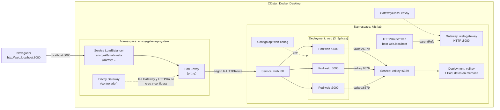

# Proyecto app · Kubernetes con Docker Desktop y Gateway API (Envoy Gateway)

Una app web con contador de visitas, desplegada en el Kubernetes de **Docker Desktop** y publicada con
**Gateway API** usando **Envoy Gateway** en **http://web.localhost:8080**.

Lo armamos de a un objeto por vez. Cada paso tiene su guía en [`pasos/`](pasos/) con qué hace cada cosa,
los comandos y **qué deberías ver**.

## Arquitectura



Hay dos planos separados:

- **Plano de control:** el Pod `envoy-gateway`. No toca el tráfico. Mira los objetos `Gateway` y `HTTPRoute` y, a partir de ellos, crea y configura los proxies.
- **Plano de datos:** el Pod de Envoy que se crea **por cada Gateway**. Es el que recibe tus visitas y las reenvía a la app.

| Pieza | Qué hace |
|---|---|
| **Namespace** `k8s-lab` | Agrupa todo el proyecto. Borrarlo borra todo lo de adentro. |
| **ConfigMap** `web-config` | Mensaje, versión y dónde está Valkey. |
| **Deployment + Service** `valkey` | La base de datos que guarda el contador, en memoria. Solo se alcanza desde adentro del clúster. |
| **Deployment + Service** `web` | La app Node con 3 copias y un nombre fijo. |
| **Envoy Gateway** | El controlador de Gateway API. Se instala con Helm junto con las CRDs. |
| **GatewayClass** `envoy` | El "tipo" de Gateway: dice que los atiende Envoy Gateway. |
| **Gateway** `web-gateway` | La puerta de entrada: HTTP en el puerto 8080. Al crearlo, Envoy Gateway levanta un proxy Envoy y su Service. |
| **HTTPRoute** `web` | La regla: el host `web.localhost` va al Service `web`. |
| **web.localhost** | Los navegadores resuelven `*.localhost` a `127.0.0.1` sin DNS. |

## Por qué Gateway API

La [documentación de Kubernetes](https://kubernetes.io/docs/concepts/services-networking/gateway/) presenta Gateway API
como el sucesor de Ingress. Divide la configuración por rol:

- **GatewayClass:** la define quien provee la infraestructura.
- **Gateway:** la define quien opera el clúster.
- **HTTPRoute:** la define quien desarrolla la app.

Gateway API no viene incluida en Kubernetes. Son CRDs (tipos de objeto nuevos) y hace falta un controlador que las implemente.
Usamos [Envoy Gateway](https://gateway.envoyproxy.io/), que figura como implementación conforme en la
[lista oficial](https://gateway-api.sigs.k8s.io/implementations/) e instala las CRDs junto con el controlador.

## Estructura

```
proyecto-app/
├── app/                      # la app Node (sin dependencias) y su Dockerfile
├── k8s/                      # los manifiestos, numerados en el orden en que se aplican
│   ├── 00-namespace.yaml
│   ├── 01-configmap.yaml
│   ├── 02-valkey.yaml
│   ├── 03-web.yaml
│   ├── 04-gatewayclass.yaml
│   ├── 05-gateway.yaml
│   └── 06-httproute.yaml
└── pasos/                    # la guía, paso a paso
```

## Los pasos

Todos los comandos se ejecutan **desde esta carpeta** (`proyecto-app/`).

| Paso | Guía | Qué se crea |
|---|---|---|
| 0 | [Requisitos](pasos/00-requisitos.md) | Nada: verificás tus herramientas |
| 1 | [El clúster](pasos/01-cluster.md) | Kubernetes en Docker Desktop |
| 2 | [La imagen](pasos/02-imagen.md) | Imagen `k8s-app:1.0` |
| 3 | [Namespace y ConfigMap](pasos/03-namespace-configmap.md) | `00` y `01` |
| 4 | [Valkey](pasos/04-valkey.md) | `02` |
| 5 | [La app web](pasos/05-web.md) | `03` |
| 6 | [Envoy Gateway](pasos/06-envoy-gateway.md) | CRDs de Gateway API, Envoy Gateway y `04` (GatewayClass) |
| 7 | [Gateway y HTTPRoute](pasos/07-gateway-httproute.md) | `05` y `06`: la app en `http://web.localhost:8080` |
| 8 | [Pruebas](pasos/08-pruebas.md) | Nada nuevo: rompemos cosas y miramos |
| 9 | [Limpieza](pasos/09-limpieza.md) | Borrás todo |

> **Importante:** antes de cada `kubectl`, confirmá que estás en el clúster de la práctica:
> `kubectl config current-context` tiene que decir `docker-desktop`.
> Si tenés otros clústeres configurados (trabajo, nube), un comando en el contexto equivocado los toca a ellos.

## Versiones usadas

| Herramienta | Versión |
|---|---|
| Envoy Gateway (chart `gateway-helm`) | v1.9.3 |
| Gateway API (CRDs, incluidas en el chart) | canal Standard |
| Valkey | 9 (alpine) |
| Node (imagen de la app) | 24 (alpine) |
