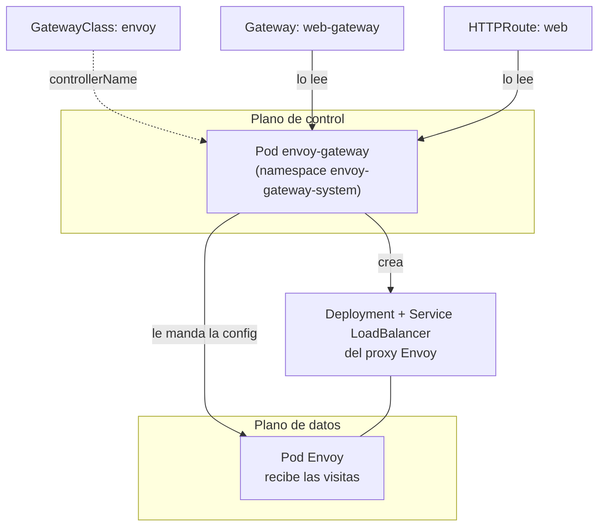
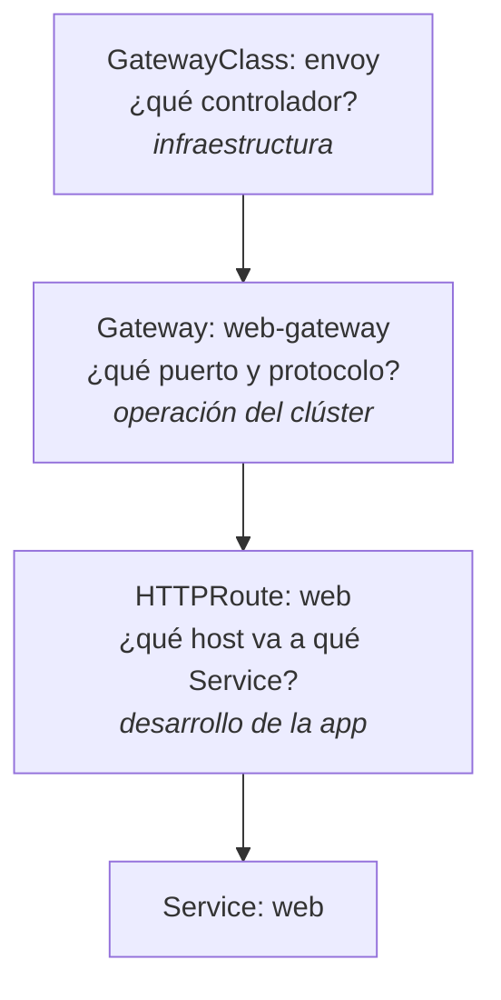

# Paso 6 · Envoy Gateway

**Objetivo:** instalar Gateway API y su controlador, y crear la GatewayClass.
**Archivo:** [`04-gatewayclass.yaml`](../k8s/04-gatewayclass.yaml)

## Qué se instala y por qué

Gateway API **no viene incluida en Kubernetes**
([documentación oficial](https://kubernetes.io/docs/concepts/services-networking/gateway/)). Hacen falta dos cosas:

| Qué | Qué es |
|---|---|
| CRDs de Gateway API | Los tipos de objeto nuevos: `GatewayClass`, `Gateway`, `HTTPRoute`, `GRPCRoute`, `ReferenceGrant` y otros |
| Un controlador | El programa que lee esos objetos y hace que el tráfico llegue de verdad |

El chart de Helm de **Envoy Gateway** instala las dos cosas juntas
([guía oficial](https://gateway.envoyproxy.io/docs/tasks/quickstart/)).

## Cómo funciona Envoy Gateway



1. El Pod `envoy-gateway` es el **controlador**. No recibe visitas: solo mira los objetos de Gateway API.
2. Cuando aparece un `Gateway` cuya GatewayClass apunta a `gateway.envoyproxy.io/gatewayclass-controller`, crea un **proxy Envoy** (Deployment + Service) para ese Gateway.
3. Cada vez que cambia una `HTTPRoute`, le manda la configuración nueva al proxy, sin reiniciarlo.
4. El **proxy Envoy** es el que recibe tus visitas y las reenvía a los Services de la app.

Un Gateway = un proxy Envoy. Si creás dos Gateways, tenés dos proxies separados.

## Los roles de Gateway API



## Pasos

```bash
kubectl config current-context        # docker-desktop
```

### 6.1 · Instalá Envoy Gateway (incluye las CRDs)

```bash
helm install eg oci://docker.io/envoyproxy/gateway-helm --version v1.9.3 \
  -n envoy-gateway-system --create-namespace
kubectl wait --timeout=5m -n envoy-gateway-system deployment/envoy-gateway --for=condition=Available
```

```bash
kubectl get pods -n envoy-gateway-system
kubectl get crd | grep gateway.networking.k8s.io
```

### 6.2 · Creá la GatewayClass

```bash
kubectl apply -f k8s/04-gatewayclass.yaml
kubectl get gatewayclass
```

## Qué deberías ver

- El Pod `envoy-gateway-...` en `Running` en `envoy-gateway-system`.
- Las CRDs `gatewayclasses`, `gateways`, `httproutes` y otras, todas `.gateway.networking.k8s.io`.
- La GatewayClass `envoy` con `CONTROLLER: gateway.envoyproxy.io/gatewayclass-controller` y `ACCEPTED: True`.

## Si algo falla

| Síntoma | Qué hacer |
|---|---|
| `helm install` falla con `... exists and cannot be imported into the current release` | Las CRDs de Gateway API ya estaban instaladas de otra forma (por ejemplo con `kubectl apply`). Borralas antes: `kubectl get crd -o name \| grep gateway.networking.k8s.io \| xargs kubectl delete`, y repetí la instalación. |
| La GatewayClass en `ACCEPTED: Unknown` | El controlador todavía arranca. Esperá unos segundos y volvé a mirar. |
| `kubectl wait` llega al timeout | `kubectl describe pod -n envoy-gateway-system -l control-plane=envoy-gateway` y mirá los Events (suele ser la descarga de la imagen). |

Siguiente: [Paso 7 · Gateway y HTTPRoute](07-gateway-httproute.md).
