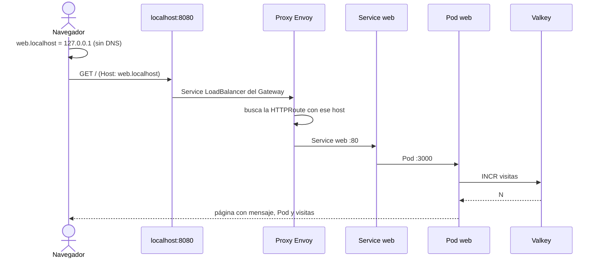

# Paso 7 · Gateway y HTTPRoute

**Objetivo:** publicar la app en http://web.localhost:8080.
**Archivos:** [`05-gateway.yaml`](../k8s/05-gateway.yaml), [`06-httproute.yaml`](../k8s/06-httproute.yaml)

## Qué hace cada uno

| Objeto | Qué hace |
|---|---|
| Gateway `web-gateway` | Abre un listener HTTP en el puerto 8080 con la GatewayClass `envoy`. Solo acepta rutas de `clase-k8s` (`from: Same`). |
| HTTPRoute `web` | Se engancha al Gateway (`parentRefs`) y dice: host `web.localhost`, cualquier ruta, va al Service `web` puerto 80. |

## web.localhost: un host sin tocar nada

Los navegadores (Chrome, Firefox, Safari, Edge) y curl resuelven cualquier nombre terminado en `.localhost` a `127.0.0.1`,
sin consultar ningún DNS. Así tenemos un nombre de verdad para la regla `hostnames`, sin editar `/etc/hosts`
ni comprar un dominio, y funciona en cualquier red.

## Por qué el puerto 8080

El listener del Gateway escucha en `8080`, no en `80`. En la Mac, el 80 suele estar ocupado
(otro programa, o Docker Desktop lo deja tomado después de resetear el clúster). Si el puerto está ocupado,
Envoy no puede publicar su Service y el Gateway queda `PROGRAMMED: False`.

## El camino de una visita



## Pasos

```bash
kubectl config current-context        # docker-desktop
kubectl apply -f k8s/05-gateway.yaml
kubectl get gateway                   # esperá PROGRAMMED: True
```

Mirá lo que creó Envoy Gateway para este Gateway:

```bash
kubectl get deploy,svc -n envoy-gateway-system
```

Aparecen un Deployment y un Service `envoy-clase-k8s-web-gateway-...`. El Service es `LoadBalancer`
y Docker Desktop lo publica en `localhost:8080`.

Ahora la regla:

```bash
kubectl apply -f k8s/06-httproute.yaml
kubectl get httproute
kubectl describe httproute web        # en Status › Parents: Accepted True y ResolvedRefs True
```

Probala:

```bash
curl http://web.localhost:8080
```

Y en el navegador: **http://web.localhost:8080**

Un host que no está en la HTTPRoute no llega a la app:

```bash
curl -i http://otro.localhost:8080     # 404: lo responde Envoy, la app ni se entera
```

## Qué deberías ver

- El Gateway con `PROGRAMMED: True`.
- En `envoy-gateway-system`, el Deployment y el Service del proxy del Gateway.
- La HTTPRoute con `HOSTNAMES: ["web.localhost"]`.
- La app en el navegador **sin `port-forward`**, con el contador de visitas subiendo.
- `404` para cualquier otro host.

## Si algo falla

| Síntoma | Qué hacer |
|---|---|
| `no matches for kind "Gateway"` | Faltan las CRDs: volvé al paso 6.1. |
| Gateway con `PROGRAMMED: False` o `Unknown` | `kubectl describe gateway web-gateway`. Revisá que la GatewayClass `envoy` esté `ACCEPTED: True`. |
| HTTPRoute con `ResolvedRefs: False` | El Service `web` no existe o el puerto no es 80. Volvé al paso 5. |
| `curl: (7) Failed to connect ... port 8080` | `kubectl get svc -n envoy-gateway-system`: el Service del proxy tiene que tener `EXTERNAL-IP`. Si otro programa usa el puerto 8080 de tu Mac (otro Service LoadBalancer, otro controlador de Gateway o Ingress, un servidor web), liberalo. |
| Gateway con `PROGRAMMED: False` y `AddressNotAssigned`; el Service del proxy con `EXTERNAL-IP <pending>` | Docker Desktop no pudo publicar el puerto del listener porque está ocupado. Mirá `kubectl get events -n envoy-gateway-system \| grep SyncLoadBalancerFailed` y `lsof -nP -iTCP:8080 -sTCP:LISTEN`. Liberá el puerto, o cambiá `port: 8080` en `05-gateway.yaml` por otro libre (por ejemplo `8081`), aplicá y usá ese puerto en la URL. El Gateway se programa solo en unos segundos. |
| `404` con `web.localhost` | La HTTPRoute no está aceptada: `kubectl describe httproute web`. |
| El navegador busca en Google en vez de abrir la página | Escribí la URL completa con `http://`. |

## Lo mismo con Ingress, para comparar

Vas a encontrar Ingress en muchos proyectos existentes. Esta HTTPRoute más el Gateway equivalen a:

```yaml
apiVersion: networking.k8s.io/v1
kind: Ingress
metadata:
  name: web
  namespace: clase-k8s
spec:
  rules:
    - host: web.localhost
      http:
        paths:
          - path: /
            pathType: Prefix
            backend:
              service:
                name: web
                port:
                  number: 80
```

Con Ingress, el puerto, el host y las rutas viven en un solo objeto. Con Gateway API se separan en Gateway (el puerto)
y HTTPRoute (el host y las rutas), para que cada equipo maneje su parte.
Este proyecto **no** usa Ingress.

Siguiente: [Paso 8 · Pruebas](08-pruebas.md).
