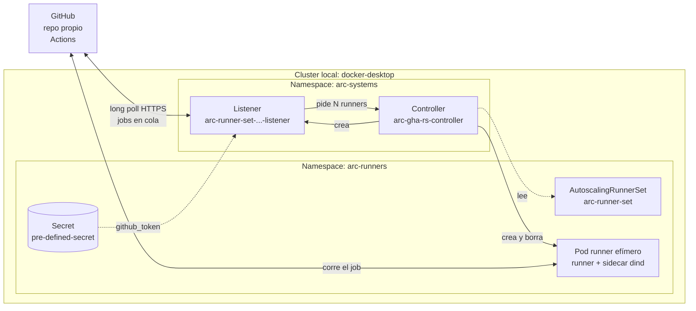

# Laboratorio 05 — GitHub Actions Runner Controller (ARC) en Kubernetes local

> Navegación: [README general](../README.md) · ← anterior: [Laboratorio 04 — Kubernetes](../04-kubernetes/README.md) · siguiente: ninguno (último lab) →

> ⚠ **Advertencia — leé esto antes de empezar.**
>
> - Un runner self-hosted ejecuta el código de los workflows **dentro de tu cluster y con acceso a tu red**.
> - Usalo **solo con repos privados y propios**. **Nunca** lo conectes a un repo público que acepta pull requests de forks: cualquiera podría correr código en tu máquina. Ver [Hardening for self-hosted runners](https://docs.github.com/en/actions/security-for-github-actions/security-guides/security-hardening-for-github-actions#hardening-for-self-hosted-runners).
> - El token (PAT) da permisos de administración sobre el repo. **No lo pegues en comandos, archivos ni capturas**, y **revocalo al terminar** (sección [Limpieza](#limpieza)).

## Objetivo

Instalar **Actions Runner Controller (ARC)** con Helm en el Kubernetes local del laboratorio 04 y registrar un **runner scale set** en un repo propio de GitHub. Al final, un workflow con `runs-on: arc-runner-set` corre en un pod efímero dentro de tu cluster.

## Qué es ARC y cómo funciona

ARC es un operador de Kubernetes mantenido por GitHub. En lugar de tener una VM con un runner siempre prendido, ARC crea **un pod por job**: el pod se registra como runner, corre el job y se borra.

Se instala con dos charts de Helm:

| Chart | Release | Namespace | Qué instala |
|---|---|---|---|
| `gha-runner-scale-set-controller` | `arc` | `arc-systems` | El controller y las CRDs (`AutoscalingRunnerSet`, `EphemeralRunnerSet`, `EphemeralRunner`, `AutoscalingListener`) |
| `gha-runner-scale-set` | `arc-runner-set` | `arc-runners` | Un runner scale set: el recurso `AutoscalingRunnerSet` que apunta a tu repo |



| Pieza | Dónde corre | Qué hace |
|---|---|---|
| **Controller** | `arc-systems` | Observa los recursos de ARC y crea el listener y los pods de runner |
| **Listener** | `arc-systems` (namespace del controller) | Mantiene una conexión con GitHub, se entera de los jobs en cola y le pide al controller cuántos runners hacen falta |
| **AutoscalingRunnerSet** | `arc-runners` | La definición del scale set: URL del repo, secret, `minRunners`, `maxRunners` |
| **Secret** `pre-defined-secret` | `arc-runners` | Guarda el PAT en la clave `github_token` |
| **Pods de runner** | `arc-runners` | Efímeros: aparecen cuando llega un job, lo corren y se borran. Con `containerMode.type: dind` traen un sidecar con Docker (ver [Docker dentro del runner (dind)](#docker-dentro-del-runner-dind)) |

> El nombre del scale set es el **nombre del release de Helm** (`arc-runner-set`), y ese es el valor que va en `runs-on`. Se puede cambiar con `runnerScaleSetName`.

## Docker dentro del runner (dind)

Por defecto el pod de runner **no tiene daemon Docker**: un `docker build` falla con `Cannot connect to the Docker daemon`. Para construir imágenes en los jobs, este lab instala el scale set con el modo Docker-in-Docker del chart:

```yaml
containerMode:
  type: "dind"
```

Con ese valor, el chart arma cada pod de runner así (nombres tomados del template del chart `gha-runner-scale-set`):

| Contenedor | Tipo | Qué hace |
|---|---|---|
| `init-dind-externals` | init container | Copia los binarios externos del runner a un volumen compartido y termina |
| `dind` | sidecar (init container con `restartPolicy: Always`) | Imagen `docker:dind` con `privileged: true`; levanta `dockerd` en `unix:///var/run/docker.sock` |
| `runner` | contenedor principal | El runner de GitHub Actions, con `DOCKER_HOST=unix:///var/run/docker.sock` apuntando al socket del sidecar |

> ⚠ **El sidecar `dind` corre como `privileged`**: tiene acceso casi total al nodo. En un cluster local propio es aceptable; en un cluster compartido o productivo no lo es. Alternativas que construyen imágenes sin privilegios: Kaniko o BuildKit en modo rootless (no se cubren en este lab).

Como `dind` es un sidecar nativo de Kubernetes, hace falta un cluster `>= 1.29` (el de Docker Desktop actual lo cumple: `kubectl version`).

## Prerrequisitos

| ✔ | Requisito | Cómo verificarlo | Resultado esperado |
|---|---|---|---|
| [ ] | Kubernetes de Docker Desktop (el del [lab 04](../04-kubernetes/README.md)); si no lo tenés, seguí [Paso 1 · El clúster](../04-kubernetes/pasos/01-cluster.md) | `kubectl get nodes` | `desktop-control-plane` en `Ready` |
| [ ] | `kubectl` | `kubectl version --client` | `Client Version: v1.x` |
| [ ] | Helm `>= 3.8` (soporte OCI) | `helm version` | `v3.8` o superior (Helm 4 también sirve) |
| [ ] | Un repo **privado y propio** en GitHub | Abrirlo en el navegador | Sos admin del repo |
| [ ] | Un PAT con los permisos de [El token (PAT)](#el-token-pat) | — | Lo tenés a mano, sin guardarlo en archivos |

> ⚠ **Contexto de kubectl.** Antes de cada paso corré `kubectl config current-context`. Tiene que decir `docker-desktop`. Si tenés otros clusters configurados (trabajo, nube), un comando en el contexto equivocado los toca a ellos.

No hace falta tener desplegada la app del lab 04: ARC usa sus propios namespaces y puede convivir con ella.

## Archivos del laboratorio

| Archivo | Para qué sirve |
|---|---|
| `README.md` | Esta guía |
| `values.yaml` | Values de ejemplo del scale set (`githubConfigSecret`, `containerMode.type: dind`, `minRunners`, `maxRunners`). **Sin secretos** |
| `workflow-ejemplo/arc-demo.yml` | Workflow de prueba con `runs-on: arc-runner-set`: un job de `echo`/`hostname` y otro con `docker version` y `docker build`. Se copia a `.github/workflows/` de tu repo |
| `workflow-ejemplo/Dockerfile` | Imagen mínima (`alpine`) que construye el job `docker`. Se copia a `arc-demo/Dockerfile` de tu repo |

## El token (PAT)

ARC necesita autenticarse contra la API de GitHub para registrar runners. Para un laboratorio alcanza con un **personal access token (PAT)**. Para uso real en repos u organizaciones, GitHub recomienda una **GitHub App** ([Authenticating ARC to the GitHub API](https://docs.github.com/en/actions/tutorials/use-actions-runner-controller/authenticate-to-the-api)).

**Opción recomendada: fine-grained PAT** (GitHub › Settings › Developer settings › Personal access tokens › Fine-grained tokens):

- **Repository access:** *Only select repositories* → solo tu repo de prueba.
- **Permissions › Repository permissions › Administration:** *Read and write*. (*Metadata: Read-only* se agrega solo.)
- **Expiration:** lo más corto posible (por ejemplo, 7 días).

**Alternativa: classic PAT** con el scope `repo` (para runners a nivel organización haría falta además `admin:org`; este lab usa runners de repo).

La URL que identifica al dueño de los runners tiene este formato:

```text
https://github.com/<owner>/<repo>
```

Por ejemplo, `https://github.com/mi-usuario/mi-repo-privado`. Sin `.git` al final y sin `/` final.

## Paso a paso

### Paso 1 · Verificar el cluster

```bash
kubectl config current-context
kubectl get nodes
helm version
```

Salida esperada:

```text
docker-desktop
NAME                    STATUS   ROLES           AGE   VERSION
desktop-control-plane   Ready    control-plane   ...   v1.x
```

### Paso 2 · Instalar el controller

```bash
NAMESPACE="arc-systems"
helm install arc \
    --namespace "${NAMESPACE}" \
    --create-namespace \
    oci://ghcr.io/actions/actions-runner-controller-charts/gha-runner-scale-set-controller
```

Helm baja el chart del registry OCI de GitHub (`ghcr.io`) e instala el controller y las CRDs. Para fijar una versión, agregá `--version <x.y.z>` (las versiones están en el [registry del chart](https://github.com/actions/actions-runner-controller/pkgs/container/actions-runner-controller-charts%2Fgha-runner-scale-set-controller)).

Verificá:

```bash
kubectl get pods -n arc-systems
```

Salida esperada (el hash cambia):

```text
NAME                                     READY   STATUS    RESTARTS   AGE
arc-gha-rs-controller-6d8c9f7b5d-x2k4p   1/1     Running   0          40s
```

> En versiones viejas del chart el pod se llama `arc-gha-runner-scale-set-controller-...`. Lo importante es que esté `Running`.

### Paso 3 · Cargar el token sin dejarlo en el historial

El comando original pone el token en una variable escrita a mano (`GITHUB_PAT="TOKEN"`), y eso queda en el historial del shell. En cambio, pedilo con `read -s` (no se ve en pantalla ni queda en el historial):

```bash
read -s -p "Pegá tu PAT: " GITHUB_PAT; echo
export GITHUB_PAT

GITHUB_CONFIG_URL="https://github.com/<owner>/<repo>"   # tu repo privado
```

Comprobá que la variable tiene algo, sin mostrarla:

```bash
echo "${#GITHUB_PAT} caracteres"
```

### Paso 4 · Crear el secret (recomendado)

En vez de pasarle el token a Helm, lo guardás en un Secret de Kubernetes y le pasás a Helm **solo el nombre** del Secret. El Secret va en el **namespace del scale set**, que tiene que existir antes:

```bash
kubectl create namespace arc-runners

kubectl create secret generic pre-defined-secret \
    --namespace arc-runners \
    --from-literal=github_token="$GITHUB_PAT"

unset GITHUB_PAT
```

Salida esperada:

```text
namespace/arc-runners created
secret/pre-defined-secret created
```

> El token no se escribe en ningún archivo ni en el historial: `"$GITHUB_PAT"` se expande en el momento. Desde acá ya no hace falta tenerlo en la terminal.

### Paso 5 · Instalar el runner scale set

Camino recomendado, con el Secret del paso 4:

```bash
INSTALLATION_NAME="arc-runner-set"
NAMESPACE="arc-runners"
helm install "${INSTALLATION_NAME}" \
    --namespace "${NAMESPACE}" \
    --create-namespace \
    --set githubConfigUrl="${GITHUB_CONFIG_URL}" \
    --set githubConfigSecret=pre-defined-secret \
    --set containerMode.type="dind" \
    oci://ghcr.io/actions/actions-runner-controller-charts/gha-runner-scale-set
```

`--create-namespace` no molesta aunque el namespace ya exista. `containerMode.type="dind"` agrega Docker al pod de runner (ver [Docker dentro del runner (dind)](#docker-dentro-del-runner-dind)). Si preferís usar el [`values.yaml`](values.yaml) del lab, que ya trae el Secret y el modo dind (desde la carpeta `05-github-actions-arc/`):

```bash
helm install arc-runner-set \
    --namespace arc-runners \
    -f values.yaml \
    --set githubConfigUrl="${GITHUB_CONFIG_URL}" \
    oci://ghcr.io/actions/actions-runner-controller-charts/gha-runner-scale-set
```

#### Variante: token en `--set` (el comando del quickstart)

Es el comando del [quickstart oficial](https://docs.github.com/en/actions/tutorials/use-actions-runner-controller/quickstart), con el agregado de `containerMode.type="dind"`. Funciona sin el paso 4, porque el chart crea el Secret por vos:

```bash
INSTALLATION_NAME="arc-runner-set"
NAMESPACE="arc-runners"
GITHUB_CONFIG_URL="https://github.com/<owner>/<repo>"
# GITHUB_PAT cargado con read -s (paso 3), nunca escrito acá
helm install "${INSTALLATION_NAME}" \
    --namespace "${NAMESPACE}" \
    --create-namespace \
    --set githubConfigUrl="${GITHUB_CONFIG_URL}" \
    --set githubConfigSecret.github_token="${GITHUB_PAT}" \
    --set containerMode.type="dind" \
    oci://ghcr.io/actions/actions-runner-controller-charts/gha-runner-scale-set
```

> ⚠ Con esta variante el token queda guardado **en los values del release de Helm**: cualquiera con acceso al namespace lo ve con `helm get values arc-runner-set -n arc-runners`. Por eso la [documentación oficial](https://docs.github.com/en/actions/tutorials/use-actions-runner-controller/deploy-runner-scale-sets) recomienda crear el Secret aparte y pasar solo su nombre.

### Paso 6 · Verificar la instalación

```bash
helm list -A
```

```text
NAME            NAMESPACE     REVISION  UPDATED  STATUS    CHART                                   APP VERSION
arc             arc-systems   1         ...      deployed  gha-runner-scale-set-controller-0.x.y   0.x.y
arc-runner-set  arc-runners   1         ...      deployed  gha-runner-scale-set-0.x.y              0.x.y
```

El listener aparece en el namespace **del controller**:

```bash
kubectl get pods -n arc-systems
```

```text
NAME                                     READY   STATUS    RESTARTS   AGE
arc-gha-rs-controller-6d8c9f7b5d-x2k4p   1/1     Running   0          3m
arc-runner-set-754b578d-listener         1/1     Running   0          20s
```

El scale set y el namespace de runners (sin pods todavía, porque `minRunners` es 0):

```bash
kubectl get autoscalingrunnersets -n arc-runners
kubectl get pods -n arc-runners
```

```text
NAME             MINIMUM RUNNERS   MAXIMUM RUNNERS   CURRENT RUNNERS   STATE   PENDING RUNNERS   RUNNING RUNNERS   FINISHED RUNNERS   DELETING RUNNERS
arc-runner-set                                       0
No resources found in arc-runners namespace.
```

En GitHub: tu repo › **Settings › Actions › Runners**. Tiene que aparecer el scale set **`arc-runner-set`**.

### Paso 7 · Correr el workflow de prueba

1. En **tu repo**, copiá [`workflow-ejemplo/arc-demo.yml`](workflow-ejemplo/arc-demo.yml) a `.github/workflows/arc-demo.yml` y [`workflow-ejemplo/Dockerfile`](workflow-ejemplo/Dockerfile) a `arc-demo/Dockerfile`:

   ```bash
   # desde la raíz de tu repo privado
   LAB=/ruta/a/terraform-devops-labs/05-github-actions-arc
   mkdir -p .github/workflows arc-demo
   cp "$LAB/workflow-ejemplo/arc-demo.yml" .github/workflows/
   cp "$LAB/workflow-ejemplo/Dockerfile" arc-demo/
   git add .github/workflows/arc-demo.yml arc-demo/Dockerfile
   git commit -m "ci: workflow de prueba para ARC"
   git push
   ```

2. En otra terminal, mirá los pods de runner:

   ```bash
   kubectl get pods -n arc-runners -w
   ```

3. En GitHub: **Actions › ARC demo › Run workflow**.

Salida esperada en la terminal del `-w`: el workflow tiene dos jobs (`demo` y `docker`), así que aparecen dos pods. Cada uno arranca, corre su job y se borra. `READY 2/2` son el `runner` y el sidecar `dind`:

```text
NAME                                READY   STATUS            RESTARTS   AGE
arc-runner-set-rmrgw-runner-p9p5n   0/2     Pending           0          0s
arc-runner-set-rmrgw-runner-k7d2q   0/2     Pending           0          0s
arc-runner-set-rmrgw-runner-p9p5n   0/2     Init:1/2          0          2s
arc-runner-set-rmrgw-runner-p9p5n   2/2     Running           0          9s
arc-runner-set-rmrgw-runner-k7d2q   2/2     Running           0          10s
arc-runner-set-rmrgw-runner-p9p5n   1/2     Completed         0          25s
arc-runner-set-rmrgw-runner-p9p5n   0/2     Terminating       0          26s
...
```

Los nombres, los tiempos y los estados intermedios varían. Mientras un pod está `Running`, comprobá sus contenedores (reemplazá el nombre por uno de tu salida):

```bash
POD=arc-runner-set-rmrgw-runner-k7d2q
kubectl get pod -n arc-runners "$POD" -o jsonpath='{.spec.initContainers[*].name}{"\n"}{.spec.containers[*].name}{"\n"}'
```

```text
init-dind-externals dind
runner
```

`dind` aparece entre los init containers porque es un sidecar nativo (`restartPolicy: Always`): sigue corriendo junto al `runner` durante todo el job.

En GitHub, el log del job:

- **demo**: el paso **Nombre del pod (hostname)** muestra el nombre del pod (`arc-runner-set-...-runner-...`).
- **docker**: `docker version` muestra las secciones `Client` y `Server` (el `Server` es el `dockerd` del sidecar), el `docker build` termina con `naming to docker.io/library/arc-demo:<run_id>` y `docker run` imprime `imagen construida dentro de un runner de ARC`.

Salí del `-w` con `Ctrl+C`.

> La primera vez el job puede tardar un poco más: el nodo tiene que bajar la imagen del runner (`ghcr.io/actions/actions-runner`).

## Verificación

- [ ] `kubectl get pods -n arc-systems` muestra el controller y el listener en `Running`.
- [ ] `helm list -A` muestra `arc` y `arc-runner-set` en `deployed`.
- [ ] El repo muestra `arc-runner-set` en **Settings › Actions › Runners**.
- [ ] El workflow **ARC demo** terminó en verde, incluido el job `docker` (`docker build` dentro del runner).
- [ ] Viste aparecer y desaparecer el pod de runner con `kubectl get pods -n arc-runners -w`.
- [ ] El token nunca quedó escrito en un archivo ni en el historial (`history | grep -i pat` no muestra el valor).

## Ejercicios opcionales

1. **Runner siempre listo.** Cambiá `minRunners: 1` en `values.yaml` y aplicalo:

   ```bash
   helm upgrade arc-runner-set \
       --namespace arc-runners \
       -f values.yaml \
       --set githubConfigUrl="${GITHUB_CONFIG_URL}" \
       oci://ghcr.io/actions/actions-runner-controller-charts/gha-runner-scale-set
   kubectl get pods -n arc-runners
   ```

   Tiene que quedar un pod de runner esperando aunque no haya jobs. Volvé a `0` al terminar.

2. **Límite de concurrencia.** Con `maxRunners: 1`, lanzá el workflow tres veces seguidas. Los jobs se ejecutan de a uno y el resto queda en cola.
3. **Otro nombre.** Descomentá `runnerScaleSetName: "mi-scale-set"`, hacé `helm upgrade` y cambiá `runs-on` en el workflow. Con el `runs-on` viejo, el job queda en *Waiting for a runner*.
4. **Desafío: el mismo despliegue con Terraform.** El provider [`hashicorp/helm`](https://registry.terraform.io/providers/hashicorp/helm/latest/docs/resources/release) instala charts con el recurso `helm_release`. Un punto de partida (no está incluido como archivo del lab; armalo en una carpeta aparte y no subas el `.tfstate`):

   ```hcl
   # Desafío: no forma parte del laboratorio. Provider hashicorp/helm ~> 3.0
   provider "helm" {
     kubernetes = {
       config_path    = "~/.kube/config"
       config_context = "docker-desktop"
     }
   }

   resource "helm_release" "arc" {
     name             = "arc"
     namespace        = "arc-systems"
     create_namespace = true
     repository       = "oci://ghcr.io/actions/actions-runner-controller-charts"
     chart            = "gha-runner-scale-set-controller"
   }

   resource "helm_release" "arc_runner_set" {
     name       = "arc-runner-set"
     namespace  = "arc-runners"
     repository = "oci://ghcr.io/actions/actions-runner-controller-charts"
     chart      = "gha-runner-scale-set"
     values     = [file("${path.module}/values.yaml")]

     set = [
       { name = "githubConfigUrl", value = var.github_config_url },
     ]

     depends_on = [helm_release.arc]
   }
   ```

   El `values.yaml` del lab ya incluye `containerMode.type: dind`, así que el runner tiene Docker también por este camino. El token **no** va en Terraform: el Secret `pre-defined-secret` se crea antes con `kubectl` (paso 4), así no termina en el `.tfstate`.

## Limpieza

El orden importa: **primero el scale set, después el controller**. Si borrás el controller primero, los recursos del scale set quedan con finalizers que nadie procesa y el namespace se traba en `Terminating`.

1. Desinstalar el scale set y esperar a que se vaya el listener:

   ```bash
   helm uninstall arc-runner-set -n arc-runners
   kubectl get pods -n arc-systems     # el pod ...-listener tiene que desaparecer
   kubectl get pods -n arc-runners     # No resources found
   ```

2. Desinstalar el controller:

   ```bash
   helm uninstall arc -n arc-systems
   ```

3. Borrar los namespaces (incluye el Secret `pre-defined-secret`):

   ```bash
   kubectl delete namespace arc-runners arc-systems
   ```

4. Verificar que no quedó nada:

   ```bash
   helm list -A
   kubectl get namespaces | grep arc     # sin resultados
   ```

   Las CRDs de ARC (`*.actions.github.com`) quedan instaladas, porque Helm no borra CRDs. Si querés sacarlas también:

   ```bash
   kubectl get crds -o name | grep actions.github.com | xargs kubectl delete
   ```

5. En GitHub:
   - Borrá `.github/workflows/arc-demo.yml` de tu repo.
   - Revisá **Settings › Actions › Runners**: `arc-runner-set` ya no tiene que aparecer.
   - **Revocá el PAT**: Settings › Developer settings › Personal access tokens › tu token › *Delete*.

6. En la terminal:

   ```bash
   unset GITHUB_PAT GITHUB_CONFIG_URL INSTALLATION_NAME NAMESPACE
   ```

> `cleanup.sh` de la raíz del repo **no** cubre este laboratorio: la limpieza del lab 05 es manual.

## Problemas comunes

| Síntoma | Causa | Solución |
|---|---|---|
| Listener en `CrashLoopBackOff` o `Error` | PAT inválido, vencido o sin el permiso *Administration: Read and write*; o `githubConfigUrl` mal escrita | `kubectl logs -n arc-systems -l app.kubernetes.io/component=runner-scale-set-listener` y `kubectl logs -n arc-systems deployment/arc-gha-rs-controller`. Corregí el token (recreá el Secret) o la URL y hacé `helm upgrade` |
| No aparece ningún pod `...-listener` | El Secret no existe en `arc-runners` o tiene otra clave | `kubectl get secret pre-defined-secret -n arc-runners -o jsonpath='{.data}' \| grep -c github_token` tiene que dar `1`. Revisá los logs del controller |
| El runner no aparece en **Settings › Actions › Runners** | URL de otro repo, o el token no tiene acceso a ese repo | Revisá `helm get values arc-runner-set -n arc-runners` (la URL) y el *Repository access* del PAT |
| `Cannot connect to the Docker daemon at unix:///var/run/docker.sock` en el job `docker` | El scale set se instaló sin `containerMode.type=dind` | Aplicalo con `helm upgrade arc-runner-set -n arc-runners -f values.yaml --set githubConfigUrl="${GITHUB_CONFIG_URL}" oci://ghcr.io/actions/actions-runner-controller-charts/gha-runner-scale-set` y volvé a correr el workflow. Verificá con el `jsonpath` del paso 7 que el pod tenga `dind` |
| El pod de runner no arranca y el evento menciona `privileged` | El cluster no permite contenedores privilegiados (Pod Security `restricted`/`baseline` en el namespace) | En el cluster local, revisá las etiquetas `pod-security.kubernetes.io/*` de `arc-runners`; si no podés usar `privileged`, sacá `containerMode` (sin `docker build`) |
| El job queda en *Waiting for a runner* | `runs-on` distinto del nombre del scale set | `runs-on: arc-runner-set` tiene que coincidir con el release de Helm (o con `runnerScaleSetName`) |
| El pod de runner queda en `Pending` o `ImagePullBackOff` | Falta de recursos en el nodo o sin red para bajar `ghcr.io/actions/actions-runner` | `kubectl describe pod -n arc-runners <pod>`; dale más memoria a Docker Desktop o revisá la conexión |
| `Error: ... failed to authorize` / `unauthorized` al bajar el chart OCI | Credenciales viejas de `ghcr.io` guardadas en Helm | `helm registry logout ghcr.io` y reintentá (el chart es público) |
| `Error: ... unsupported protocol scheme "oci"` | Helm anterior a 3.8 | Actualizá Helm (`helm version` tiene que dar `v3.8` o superior) |
| `namespaces "arc-runners" not found` al crear el Secret | El namespace no existe todavía | `kubectl create namespace arc-runners` antes del Secret |
| El namespace queda en `Terminating` | Se desinstaló el controller antes que el scale set | Reinstalá el controller (paso 2), desinstalá `arc-runner-set` y recién después el controller |
| Los comandos afectan a otro cluster | Contexto de `kubectl` equivocado | `kubectl config use-context docker-desktop` |

Más casos en [Troubleshooting Actions Runner Controller errors](https://docs.github.com/en/actions/tutorials/use-actions-runner-controller/troubleshoot).

## Preguntas de repaso

1. **¿Qué valor va en `runs-on`?** El nombre del scale set, que por defecto es el nombre del release de Helm (`arc-runner-set`).
2. **¿Dónde corre el listener y dónde los runners?** El listener en el namespace del controller (`arc-systems`); los pods de runner en el namespace del scale set (`arc-runners`).
3. **¿Qué agrega `containerMode.type: dind`?** Un sidecar `dind` privilegiado con `dockerd` y `DOCKER_HOST` en el contenedor `runner`, para que los jobs puedan hacer `docker build`.
4. **¿Por qué conviene `githubConfigSecret=pre-defined-secret` en lugar de `githubConfigSecret.github_token=...`?** Porque el token no queda en los values del release de Helm ni en el historial del shell.
5. **¿Por qué no se usan runners self-hosted en repos públicos?** Porque un pull request desde un fork podría ejecutar código arbitrario en tu cluster y tu red.
6. **¿En qué orden se desinstala?** Primero el scale set, después el controller, y al final se revoca el PAT.

## Fuentes

Contenido parafraseado de la documentación oficial de GitHub:

- [Quickstart for Actions Runner Controller](https://docs.github.com/en/actions/tutorials/use-actions-runner-controller/quickstart)
- [Deploying runner scale sets with Actions Runner Controller](https://docs.github.com/en/actions/tutorials/use-actions-runner-controller/deploy-runner-scale-sets)
- [Authenticating ARC to the GitHub API](https://docs.github.com/en/actions/tutorials/use-actions-runner-controller/authenticate-to-the-api)
- [values.yaml del chart `gha-runner-scale-set`](https://github.com/actions/actions-runner-controller/blob/master/charts/gha-runner-scale-set/values.yaml)
- [Security hardening for self-hosted runners](https://docs.github.com/en/actions/security-for-github-actions/security-guides/security-hardening-for-github-actions#hardening-for-self-hosted-runners)
- [Terraform: recurso `helm_release`](https://registry.terraform.io/providers/hashicorp/helm/latest/docs/resources/release)
