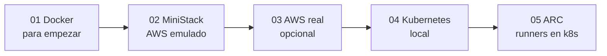
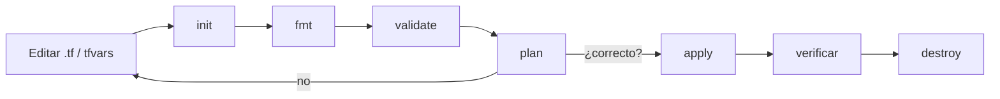

# Terraform DevOps Labs


Laboratorios prácticos de Terraform: de Docker local a AWS.

Material práctico para aprender Terraform desde cero. Vas a recorrer tres laboratorios, de lo local a la nube: un Nginx en Docker, una API serverless contra un emulador de AWS y la misma API en AWS real. Cada laboratorio es una configuración raíz de Terraform independiente, con su propio state local. No se usan módulos ni workspaces. Después siguen dos labs de Kubernetes local, sin Terraform: el 04 despliega una app con Gateway API y el 05 instala runners self-hosted de GitHub Actions con Actions Runner Controller (ARC).

Seguí este README de arriba hacia abajo: primero prerrequisitos, después los labs en orden y al final la limpieza y el checklist. La teoría que acompaña cada lab está en [docs/teoria-terraform.md](docs/teoria-terraform.md).

## 1. Ruta de aprendizaje

| Lab | Qué despliega | Qué aprendés | Dónde corre | Costo | Carácter |
|---|---|---|---|---|---|
| [01 — Docker](01-terraform-docker/README.md) | Imagen y contenedor Nginx en `localhost:8080` | Ciclo `init → plan → apply → destroy`, variables, outputs, state, reemplazo y drift | Tu máquina (Docker) | Ninguno | **Recomendado para empezar** |
| [02 — MiniStack](02-terraform-aws-ministack/README.md) | API Gateway HTTP API + Lambda (Python) + DynamoDB + IAM | Leer una arquitectura AWS en Terraform, dependencias, permisos, probar una API | Tu máquina (emulador MiniStack en Docker) | Ninguno | Local, AWS emulado |
| [03 — AWS real](03-terraform-aws-real/README.md) | La misma API del lab 02 | Credenciales, región, roles IAM, limpieza verificada en la nube | Cuenta AWS de práctica | Puede generar costos | **Opcional**, usa AWS real (solo en cuenta autorizada) |
| [04 — Kubernetes](04-kubernetes/README.md) | App web Node + Valkey publicada con Gateway API (Envoy Gateway) | Objetos de Kubernetes, `kubectl`, Helm, Gateway y HTTPRoute | Tu máquina (Kubernetes de Docker Desktop) | Ninguno | Local, sin Terraform |
| [05 — GitHub Actions ARC](05-github-actions-arc/README.md) | Controller de ARC + runner scale set con Docker-in-Docker | Runners self-hosted efímeros en Kubernetes, charts OCI, secrets, `runs-on` | Tu máquina (Kubernetes de Docker Desktop) + repo GitHub propio | Ninguno | Local; requiere repo privado propio y PAT |



## 2. Prerrequisitos

| Herramienta | Versión | Para qué lab | Cómo verificarla |
|---|---|---|---|
| Terraform CLI | `>= 1.5.0` (`required_version` de los `versions.tf`) | 01, 02, 03 | `terraform version` |
| Provider `kreuzwerker/docker` | `~> 4.2.0` (lo descarga `terraform init`) | 01 | `terraform providers` (dentro del lab) |
| Providers `hashicorp/aws` y `hashicorp/archive` | `~> 6.0` y `~> 2.0` (los descarga `terraform init`) | 02, 03 | `terraform providers` (dentro del lab) |
| Docker Engine o Docker Desktop | Encendido | 01, 02 | `docker info` |
| MiniStack | Imagen `ministackorg/ministack`, puerto `4566` | 02 | `curl http://localhost:4566/_ministack/health` |
| AWS CLI | v2 | 03 (opcional en 02) | `aws --version` |
| `curl` | Cualquiera reciente | 01, 02, 03 | `curl --version` |
| bash | 4+ recomendado (macOS trae 3.2 y alcanza) | Scripts `.sh` | `bash --version` |
| Cuenta AWS de práctica | Sandbox autorizado, credenciales temporales | Solo 03 | `aws sts get-caller-identity` |
| Kubernetes de Docker Desktop | Activado en Settings › Kubernetes | 04, 05 | `kubectl config current-context` → `docker-desktop` |
| `kubectl` | Cualquiera reciente | 04, 05 | `kubectl version --client` |
| Helm | `>= 3.8` (soporte OCI) | 04, 05 | `helm version` |
| Repo GitHub propio + PAT | Repo privado; PAT con permisos mínimos | Solo 05 | Ver [El token (PAT)](05-github-actions-arc/README.md#el-token-pat) |

En **Windows**, los scripts `.sh` (`cleanup.sh`, `api.sh`, `aws-credentials.sh`) se ejecutan desde **WSL2** o **Git Bash**. Los comandos de Terraform funcionan igual en PowerShell (para copiar archivos: `Copy-Item origen destino`).

Tip opcional: los labs 02 y 03 usan el mismo provider AWS (~150 MB). Para descargarlo una sola vez:

```bash
mkdir -p "$HOME/.terraform.d/plugin-cache"
export TF_PLUGIN_CACHE_DIR="$HOME/.terraform.d/plugin-cache"
```

## 3. Mapa del repositorio

```text
terraform-devops-labs/
├── README.md                                   # Este archivo: guía general de los labs
├── docs/
│   └── teoria-terraform.md                     # Teoría para leer junto con los labs
├── cleanup.sh                                  # Limpieza segura de los labs 01–03
├── .gitignore                                  # Ignora state, tfvars, credenciales, .terraform/ y lambda.zip
├── 01-terraform-docker/
│   ├── README.md                               # Paso a paso del lab 01
│   ├── versions.tf · providers.tf              # Versiones y conexión con Docker
│   ├── main.tf                                 # docker_image.nginx + docker_container.web
│   ├── variables.tf · outputs.tf               # container_name, image_name, external_port / url_web, container_name
│   ├── terraform.tfvars.example                # Plantilla: copiala a terraform.tfvars
│   └── .terraform.lock.hcl                     # Versiones exactas de providers (se versiona)
├── 02-terraform-aws-ministack/
│   ├── README.md                               # Paso a paso del lab 02
│   ├── versions.tf · providers.tf              # Provider AWS apuntado a MiniStack (credenciales "test")
│   ├── main.tf                                 # DynamoDB, IAM, Lambda, API Gateway (13 recursos)
│   ├── variables.tf · outputs.tf               # aws_region, project_name, ministack_endpoint / api_url, api_id, table_name, lambda_name
│   ├── lambda/index.py                         # Código de la Lambda (CRUD de productos)
│   ├── api.sh                                  # Prueba la API o carga datos (arma la URL local desde api_id)
│   ├── terraform.tfvars.example                # Plantilla: copiala a terraform.tfvars
│   └── .terraform.lock.hcl
├── 03-terraform-aws-real/
│   ├── README.md                               # Paso a paso del lab 03 (incluye credenciales)
│   ├── versions.tf · providers.tf              # Provider AWS estándar (credenciales del entorno)
│   ├── main.tf                                 # Misma infra; el rol IAM es opcional (13 o 10 recursos)
│   ├── variables.tf · outputs.tf               # aws_region, project_name, lambda_role_arn / mismos outputs que el 02
│   ├── lambda/index.py                         # Igual al del lab 02
│   ├── api.sh                                  # Prueba la API usando terraform output api_url
│   ├── terraform.tfvars.example                # Plantilla: copiala a terraform.tfvars
│   ├── aws-credentials.sh.example              # Plantilla: copiala a aws-credentials.sh y usala con source
│   ├── iam-examples/                           # Trust y permissions policy para reutilizar un rol
│   │   ├── README.md
│   │   ├── trust-policy.json
│   │   └── permissions-policy.json
│   └── .terraform.lock.hcl
├── 04-kubernetes/
│   ├── README.md                               # Arquitectura y orden de los pasos del lab 04
│   ├── app/                                    # App Node (Dockerfile, package.json, server.js)
│   ├── k8s/                                    # Manifiestos: namespace, ConfigMap, Valkey, web, Gateway API
│   └── pasos/                                  # Guía paso a paso (00 a 09)
└── 05-github-actions-arc/
    ├── README.md                               # Paso a paso del lab 05 (ARC con Helm)
    ├── values.yaml                             # Values del runner scale set (dind, min/max runners), sin secretos
    └── workflow-ejemplo/
        ├── arc-demo.yml                        # Workflow de prueba: runs-on: arc-runner-set
        └── Dockerfile                          # Imagen mínima que construye el workflow
```

Los archivos que creás vos (`terraform.tfvars`, `aws-credentials.sh`) y los que genera Terraform (`.terraform/`, `terraform.tfstate*`, `lambda.zip`) están ignorados por Git.

## 4. Quick start (lab 01)

Si Terraform y Docker ya funcionan, en ocho comandos tenés el primer recurso creado y destruido:

```bash
cd 01-terraform-docker
cp terraform.tfvars.example terraform.tfvars
terraform init
terraform validate
terraform plan                 # Plan: 2 to add, 0 to change, 0 to destroy.
terraform apply                # escribí yes
curl -I http://localhost:8080  # HTTP/1.1 200 OK
terraform destroy              # escribí yes
```

El detalle de cada paso, las salidas esperadas y los ejercicios están en el [README del lab 01](01-terraform-docker/README.md).

## 5. Flujo estándar de Terraform

Es el mismo en los tres labs. Todos los comandos se ejecutan **dentro de la carpeta del lab**.

| Comando | Qué hace | ¿Modifica infraestructura? |
|---|---|---|
| `terraform init` | Prepara la carpeta y descarga providers (`.terraform/`) | No |
| `terraform fmt` | Formatea los `.tf` | Solo archivos locales |
| `terraform validate` | Revisa sintaxis y referencias | No |
| `terraform plan` | Muestra qué va a crear (`+`), cambiar (`~`), destruir (`-`) o reemplazar (`-/+`) | No |
| `terraform apply` | Ejecuta el plan después de que escribís `yes` | **Sí** |
| `terraform output` | Muestra los outputs | No |
| `terraform state list` | Lista los recursos que administra el state | No |
| `terraform plan -destroy` | Muestra qué se destruiría | No |
| `terraform destroy` | Elimina los recursos administrados después de `yes` | **Sí** |



Regla de oro: **leé el plan antes de cada `apply`**. Si propone destruir algo que no esperabas, no apliques.

## 6. Laboratorios

**Lab 01 — Docker (recomendado para empezar)** · [README](01-terraform-docker/README.md) · [Teoría §3](docs/teoria-terraform.md#3-laboratorio-01-docker--terraform)

- [ ] `terraform version` y `docker info` responden
- [ ] `cp terraform.tfvars.example terraform.tfvars`
- [ ] `init`, `fmt`, `validate` y `plan` con `Plan: 2 to add`
- [ ] `apply` y `curl -I http://localhost:8080` devuelve `200 OK`
- [ ] Ejercicio de puerto `8081` (reemplazo) y de drift (`docker rm -f web-terraform`)
- [ ] `terraform destroy` o `./cleanup.sh --lab 01`

**Lab 02 — MiniStack (local, AWS emulado)** · [README](02-terraform-aws-ministack/README.md) · [Teoría §4](docs/teoria-terraform.md#4-laboratorios-02-y-03-arquitectura-aws)

- [ ] `docker run -d --name ministack -p 4566:4566 ministackorg/ministack`
- [ ] `curl http://localhost:4566/_ministack/health` responde
- [ ] `cp terraform.tfvars.example terraform.tfvars` y tu `project_name`
- [ ] `plan` con `Plan: 13 to add` y `apply`
- [ ] `./api.sh "" test` termina con `Resultado: TODO OK`
- [ ] `terraform destroy` o `./cleanup.sh --lab 02`, y `docker rm -f ministack`

**Lab 03 — AWS real (opcional, cuenta autorizada)** · [README](03-terraform-aws-real/README.md) · [Teoría §4.5](docs/teoria-terraform.md#45-ministack-local-vs-aws-real)

- [ ] Leíste la advertencia de costos y API pública
- [ ] `cp aws-credentials.sh.example aws-credentials.sh`, completar y `source aws-credentials.sh`
- [ ] `aws sts get-caller-identity` muestra la cuenta de práctica
- [ ] `cp terraform.tfvars.example terraform.tfvars`: misma región que `AWS_REGION` y `lambda_role_arn` según [iam-examples](03-terraform-aws-real/iam-examples/README.md)
- [ ] `plan` con `13 to add` (o `10` si reutilizás un rol) y `apply`
- [ ] `./api.sh "" test` termina con `Resultado: TODO OK`
- [ ] `terraform destroy` o `./cleanup.sh --lab 03`, verificación con AWS CLI y `unset` de credenciales

**Lab 04 — Kubernetes (local)** · [README](04-kubernetes/README.md)

- [ ] `kubectl config current-context` dice `docker-desktop`
- [ ] Seguiste los pasos de [`04-kubernetes/pasos/`](04-kubernetes/pasos/) en orden
- [ ] Limpieza según el paso 9 de esa guía

**Lab 05 — GitHub Actions ARC** · [README](05-github-actions-arc/README.md)

- [ ] Leíste la advertencia: runners self-hosted solo en repos privados y propios
- [ ] Controller instalado: `kubectl get pods -n arc-systems` lo muestra `Running`
- [ ] PAT cargado con `read -s` y guardado en el Secret `pre-defined-secret`, nunca en archivos
- [ ] Scale set instalado con `containerMode.type=dind` y listener `Running` en `arc-systems`
- [ ] `arc-runner-set` visible en Settings › Actions › Runners de tu repo
- [ ] Workflow `arc-demo.yml` en verde, incluido el `docker build`
- [ ] [Limpieza](05-github-actions-arc/README.md#limpieza): scale set, controller, namespaces y PAT revocado

## 7. Limpieza con `cleanup.sh`

Los labs 04 y 05 no usan Terraform y se limpian a mano: ver el paso 9 del [lab 04](04-kubernetes/README.md) y la [limpieza del lab 05](05-github-actions-arc/README.md#limpieza).

`cleanup.sh` limpia los labs 01, 02 y 03 desde cualquier carpeta (opera siempre sobre el directorio donde está el script). Si un lab todavía tiene recursos en su `terraform.tfstate`, **primero ejecuta `terraform destroy`** y recién después borra los archivos generados.

```text
Uso: ./cleanup.sh [opciones]
  -n, --dry-run      Muestra lo que haría, sin borrar ni destruir nada
  -y, --yes          No pide confirmación general (el destroy del lab 03 SIEMPRE pide "yes")
      --no-destroy   No ejecuta terraform destroy; conserva los tfstate que todavía tengan recursos
      --purge-locks  Borra también .terraform.lock.hcl
      --lab NN       Limita a un lab: 01, 02 o 03 (se puede repetir)
  -h, --help         Muestra esta ayuda
```

Ejemplos (desde la raíz del repo):

```bash
./cleanup.sh --dry-run            # ver qué haría, sin tocar nada
./cleanup.sh                      # limpiar los tres labs (pide confirmación)
./cleanup.sh --lab 01 --yes       # destroy y limpieza del lab 01 sin preguntas
./cleanup.sh --yes --no-destroy   # borrar solo archivos generados, sin destroy
```

| Borra | NO borra |
|---|---|
| `.terraform/`, `lambda.zip`, `tfplan`, `*.tfplan`, `crash.log`, `.terraform.tfstate.lock.info` | `terraform.tfvars`, `*.example`, `aws-credentials.sh` |
| `terraform.tfstate` y `.backup`, **solo** si el state quedó vacío o se destruyó | Un state con recursos si el destroy falló o usaste `--no-destroy` |
| `.terraform.lock.hcl`, **solo** con `--purge-locks` | El contenedor de MiniStack (apagalo con `docker rm -f ministack`) |
| El contenedor huérfano del lab 01 (`web-terraform`, sin state), pidiendo confirmación salvo con `--yes` | Recursos que Terraform no administra (por ejemplo, el log group de CloudWatch del lab 03) |

Antes de cada destroy verifica el prerrequisito: `docker info` (01), `/_ministack/health` (02) o `aws sts get-caller-identity` (03). Si falta, **conserva el state** para que puedas destruir después, y termina con código de salida 1.

## 8. Seguridad y buenas prácticas

- **No subas a Git** `terraform.tfstate`, `terraform.tfvars` ni `aws-credentials.sh`: pueden tener datos de tu cuenta o credenciales. El [`.gitignore`](.gitignore) ya los excluye; revisá `git status` antes de cada commit.
- Se versionan solo las plantillas `.example` (con placeholders como `<ACCOUNT_ID>` y `<TU_ACCESS_KEY_ID>`) y los `.terraform.lock.hcl`.
- **Nunca** escribas credenciales en archivos `.tf`. El lab 03 las toma del entorno (`source aws-credentials.sh` o `AWS_PROFILE`).
- Preferí **credenciales temporales** (sandbox, SSO, STS) y sacalas de la terminal al terminar con `unset`.
- Las credenciales `test` del lab 02 son ficticias y solo valen para MiniStack.
- Cada lab tiene **su propio state**: no copies `terraform.tfstate` entre carpetas.
- **Destruí siempre** lo que creaste y, en AWS, verificá con la AWS CLI que no quedó nada.
- La API de los labs 02 y 03 no tiene autenticación: es didáctica, **no apta para producción**.
- En el lab 05, el PAT de GitHub va en un Secret de Kubernetes, nunca en comandos ni archivos. Usá runners self-hosted solo en repos privados y propios, y revocá el PAT al terminar.

## 9. Troubleshooting común

| Síntoma | Lab | Causa probable | Solución |
|---|---|---|---|
| `terraform: command not found` | Todos | Terraform no está en el `PATH` | Instalalo y verificá con `terraform version` |
| `Cannot connect to the Docker daemon` | 01, 02 | Docker apagado o socket no encontrado | Encendé Docker y verificá `docker info`. Ver [lab 01](01-terraform-docker/README.md#problemas-comunes) (macOS y Windows) |
| `port is already allocated` | 01, 02 | Puerto 8080 o 4566 ocupado | Liberalo o cambiá `external_port` / el puerto de MiniStack |
| `Conflict. The container name ... is already in use` | 01, 02 | Contenedor con el mismo nombre | `docker rm -f <nombre>` o cambiá `container_name` |
| `connection refused` en `localhost:4566` | 02 | MiniStack no está corriendo | `docker start ministack` y `curl http://localhost:4566/_ministack/health` |
| `api.sh` avisa que ningún formato de URL respondió 200 | 02 | El emulador no invoca la API en tu versión | Ver [lab 02](02-terraform-aws-ministack/README.md#problemas-comunes); el aprendizaje es el plan |
| `No valid credential sources found` | 03 | No cargaste credenciales en esta terminal | `source aws-credentials.sh` y `aws sts get-caller-identity` |
| `ExpiredToken` / `InvalidClientTokenId` | 03 | Credenciales vencidas, mal copiadas o sin `AWS_SESSION_TOKEN` | Renovalas y repetí `source aws-credentials.sh` |
| `AccessDenied` en `iam:CreateRole` | 03 | No podés crear roles | Usá `lambda_role_arn` con un rol existente ([iam-examples](03-terraform-aws-real/iam-examples/README.md)) |
| La API responde `500` | 02, 03 | Permisos de DynamoDB del rol o error en la Lambda | Revisá el rol y los logs (`aws logs tail /aws/lambda/<project_name>-api`; en el 02 agregá `--endpoint-url=http://localhost:4566`) |
| Los recursos "no aparecen" en AWS | 03 | Región distinta entre `aws_region` y `AWS_REGION` | Usá la misma región en todos lados |
| `cleanup.sh` termina con "conservado (no se pudo destruir: falta prerrequisito)" | Todos | Docker, MiniStack o credenciales no disponibles | Resolvé el prerrequisito y volvé a correrlo |
| Listener de ARC en `CrashLoopBackOff` | 05 | PAT inválido o vencido, o `githubConfigUrl` mal escrita | Ver [lab 05](05-github-actions-arc/README.md#problemas-comunes) |
| Job en *Waiting for a runner* | 05 | `runs-on` distinto del nombre del scale set (`arc-runner-set`) | Ver [lab 05](05-github-actions-arc/README.md#problemas-comunes) |
| `cleanup.sh` termina con "conservado (state ilegible)" | Todos | Falta Terraform, o no pudo leer el state ni ejecutar `terraform init` (sin red) | Leé el motivo que imprime, corré `terraform -chdir=<lab> init` y volvé a correrlo |

## 10. Material teórico

La teoría está en [docs/teoria-terraform.md](docs/teoria-terraform.md). Leela antes de cada lab o cuando un paso no te quede claro; los comandos están en los README de cada lab.

- [§1 Por qué existe IaC](docs/teoria-terraform.md#1-por-qué-existe-iac): manual vs IaC y dónde encaja en DevOps.
- [§2 Terraform desde cero](docs/teoria-terraform.md#2-terraform-desde-cero): bloques HCL, ciclo de comandos y state.
- [§3 Laboratorio 01: Docker + Terraform](docs/teoria-terraform.md#3-laboratorio-01-docker--terraform): qué pasa en cada `plan`, reemplazo y drift.
- [§4 Laboratorios 02 y 03: arquitectura AWS](docs/teoria-terraform.md#4-laboratorios-02-y-03-arquitectura-aws): API Gateway, Lambda, DynamoDB, IAM y MiniStack vs AWS real.
- [§5 Errores comunes](docs/teoria-terraform.md#5-errores-comunes), [§7 Ejercicios opcionales](docs/teoria-terraform.md#7-ejercicios-opcionales) y [§8 Preguntas frecuentes](docs/teoria-terraform.md#8-preguntas-frecuentes).

## 11. Checklist final

- [ ] Puedo explicar qué es IaC y en qué se diferencia Terraform de Docker.
- [ ] Sé qué hacen `init`, `fmt`, `validate`, `plan`, `apply` y `destroy`, y cuáles modifican infraestructura.
- [ ] Leo un plan y distingo `+`, `~`, `-` y `-/+`.
- [ ] Entiendo para qué sirven `variables.tf`, `terraform.tfvars` y `outputs.tf`.
- [ ] Sé qué es el state, por qué no se borra para "arreglar" errores y por qué no se sube a Git.
- [ ] Completé el lab 01: creé, modifiqué (puerto 8081), detecté drift y destruí.
- [ ] Puedo explicar la arquitectura API Gateway → Lambda → DynamoDB y el rol de IAM.
- [ ] Ejecuté (o al menos leí el plan de) el lab 02 y entiendo por qué tiene un state separado del 03.
- [ ] Si hice el lab 03: destruí todo, verifiqué con la AWS CLI y saqué las credenciales con `unset`.
- [ ] Corrí `./cleanup.sh --dry-run` y entiendo qué borra y qué conserva.
