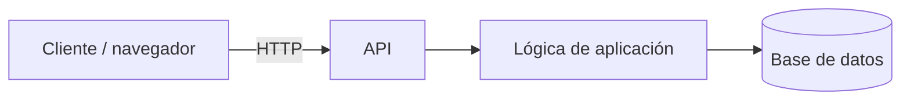
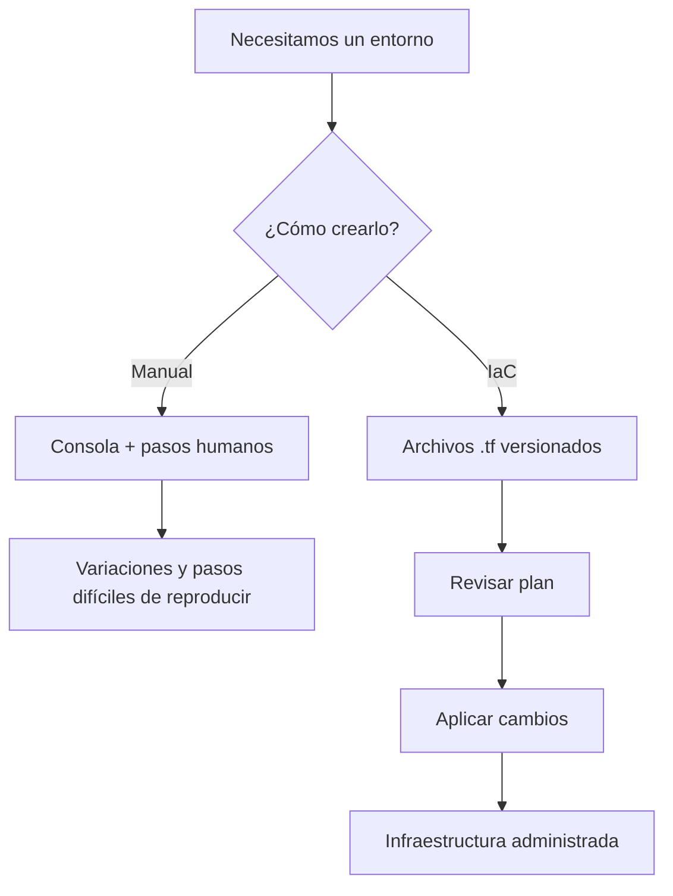
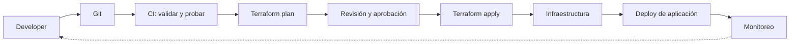
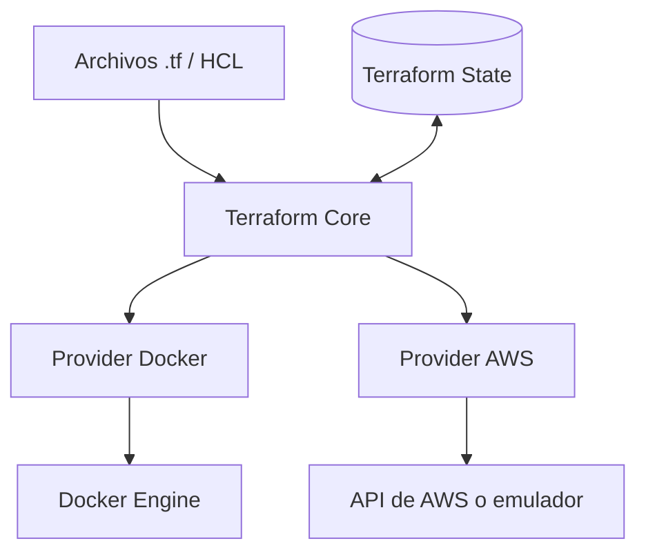
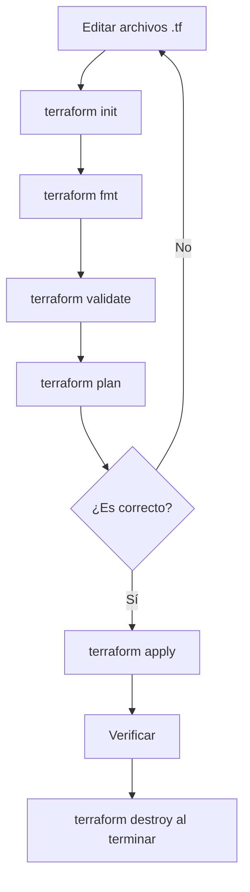
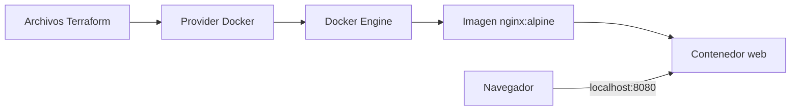
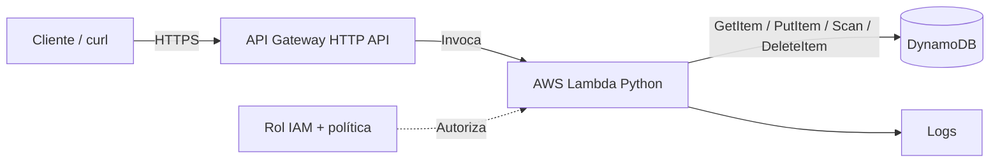
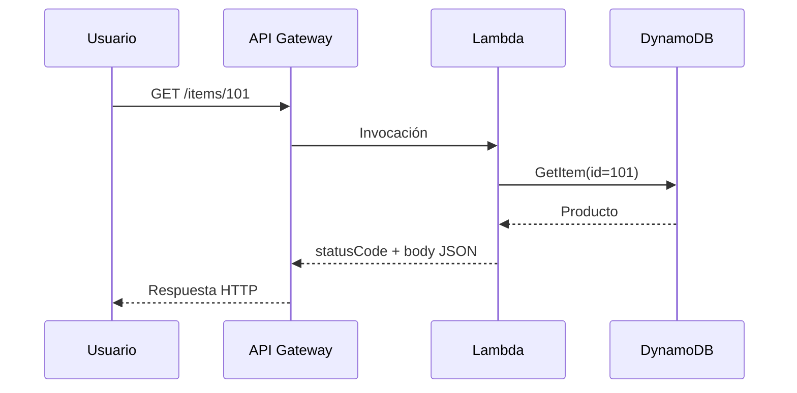
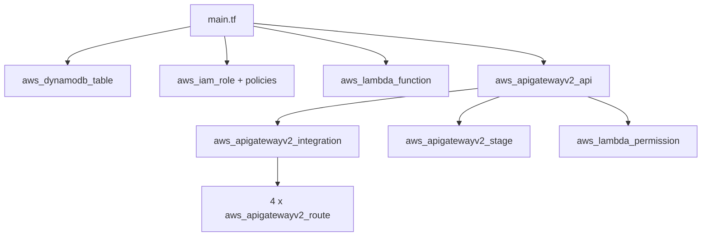
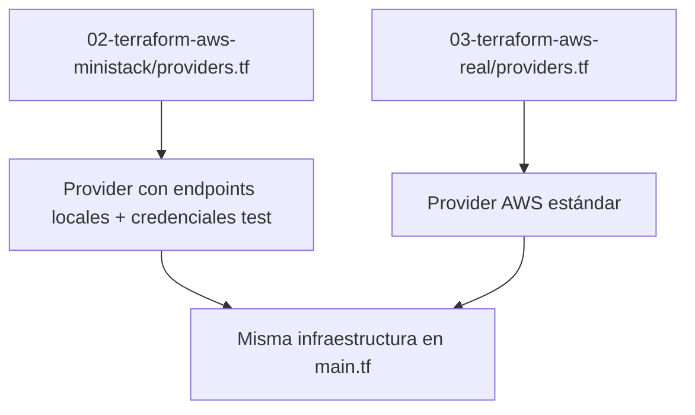

# Teoría de Terraform

Este documento es la teoría que acompaña los laboratorios. Al terminar vas a poder explicar qué problema resuelve la Infraestructura como Código (IaC), cómo piensa Terraform, cómo leer los bloques HCL y cómo construir, comprobar, modificar y eliminar infraestructura de forma controlada.

Los comandos paso a paso están en el [README general](../README.md) y en el README de cada laboratorio: [01 Docker](../01-terraform-docker/README.md) (recomendado para empezar), [02 MiniStack](../02-terraform-aws-ministack/README.md) (local con AWS emulado, depende de que el emulador soporte los servicios) y [03 AWS real](../03-terraform-aws-real/README.md) (opcional, usa AWS real; solo en una cuenta de práctica autorizada). Leé cada sección de teoría antes del lab correspondiente o cuando un paso no te quede claro.

## Índice

- [1. Por qué existe IaC](#1-por-qué-existe-iac)
  - [1.1 Un ejemplo: la tienda de productos](#11-un-ejemplo-la-tienda-de-productos)
  - [1.2 Infraestructura manual vs IaC](#12-infraestructura-manual-vs-iac)
  - [1.3 Dónde encaja IaC en DevOps](#13-dónde-encaja-iac-en-devops)
- [2. Terraform desde cero](#2-terraform-desde-cero)
  - [2.1 Qué hace Terraform](#21-qué-hace-terraform)
  - [2.2 La sintaxis HCL](#22-la-sintaxis-hcl)
  - [2.3 Por qué varios archivos](#23-por-qué-varios-archivos)
  - [2.4 El ciclo de comandos](#24-el-ciclo-de-comandos)
  - [2.5 El state](#25-el-state)
- [3. Laboratorio 01: Docker + Terraform](#3-laboratorio-01-docker--terraform)
  - [3.1 Qué vas a construir](#31-qué-vas-a-construir)
  - [3.2 Cómo leer main.tf](#32-cómo-leer-maintf)
  - [3.3 Qué pasa en plan y apply](#33-qué-pasa-en-plan-y-apply)
  - [3.4 Cambio controlado y drift](#34-cambio-controlado-y-drift)
  - [3.5 Destroy: limpiar y verificar](#35-destroy-limpiar-y-verificar)
- [4. Laboratorios 02 y 03: arquitectura AWS](#4-laboratorios-02-y-03-arquitectura-aws)
  - [4.1 La API de productos](#41-la-api-de-productos)
  - [4.2 La arquitectura](#42-la-arquitectura)
  - [4.3 De la arquitectura a Terraform](#43-de-la-arquitectura-a-terraform)
  - [4.4 El código Python de la Lambda](#44-el-código-python-de-la-lambda)
  - [4.5 MiniStack local vs AWS real](#45-ministack-local-vs-aws-real)
- [5. Errores comunes](#5-errores-comunes)
- [6. Seguridad y buenas prácticas](#6-seguridad-y-buenas-prácticas)
- [7. Ejercicios opcionales](#7-ejercicios-opcionales)
- [8. Preguntas frecuentes](#8-preguntas-frecuentes)
- [9. Referencias oficiales](#9-referencias-oficiales)

---

## 1. Por qué existe IaC

Cuando terminás el código de una aplicación, alguien tiene que crear el servidor, el contenedor, los permisos, la base de datos y la red. Si eso depende de una persona haciendo clic en una consola, aparecen los clásicos "en mi máquina funciona": un puerto distinto, una variable de entorno ausente, una base sin crear, permisos faltantes o una versión de software diferente. IaC existe para resolver ese problema.

### 1.1 Un ejemplo: la tienda de productos

Una tienda necesita consultar productos. El frontend o un usuario llama a una API; una función ejecuta la lógica; una base guarda los datos. La infraestructura no es lo mismo que el código de la aplicación.



- El **cliente** consume el servicio.
- La **API** define cómo te comunicás mediante HTTP.
- La **lógica** procesa la solicitud y toma decisiones.
- La **base de datos** persiste la información.
- Además hacen falta red, permisos, configuración, observabilidad y un lugar donde ejecutar todo.

Ahora pensá: si necesitás esa misma arquitectura también en testing, ¿la volverías a crear a mano?

### 1.2 Infraestructura manual vs IaC

**Sin IaC:** una persona abre la consola, elige una región, crea la tabla, luego una función, luego los permisos, anota los pasos en un documento y espera que todos los repitan bien.

**Con IaC:** declarás la infraestructura en archivos versionables y revisás qué quiere cambiar la herramienta antes de aplicar.



**Definición:** Infraestructura como Código (IaC) es la práctica de describir y administrar infraestructura mediante código o configuración, en lugar de depender únicamente de cambios manuales.

**Beneficios:** reproducibilidad, trazabilidad, colaboración en Git, revisión previa, automatización y menos inconsistencias.

**Límites:** un archivo IaC no recupera por sí solo los datos de una base, no elimina los riesgos de aplicar cambios y no vuelve automáticamente seguros los permisos.

### 1.3 Dónde encaja IaC en DevOps

DevOps es una manera de colaborar y automatizar el ciclo del software. IaC ayuda con el aprovisionamiento, pero no reemplaza ni a CI/CD ni al monitoreo.



| Concepto | Respuesta sencilla | Ejemplo |
|---|---|---|
| IaC | ¿Qué infraestructura necesito? | Declarar una tabla DynamoDB |
| Docker | ¿Cómo empaqueto y ejecuto mi aplicación? | Ejecutar Nginx |
| Terraform | ¿Cómo administro recursos declarativamente? | Crear un contenedor mediante el provider Docker |
| CI/CD | ¿Cómo valido y entrego cambios automáticamente? | Pipeline con plan y aprobación |
| Kubernetes | ¿Cómo orquesto contenedores? | Mantener varias réplicas de una app |
| Ansible | ¿Cómo automatizo tareas y configuraciones? | Instalar paquetes y ajustar servicios |

**Idea clave:** Docker y Terraform no compiten. Docker se ocupa de los contenedores; Terraform puede gestionar recursos de Docker y también de AWS.

---

## 2. Terraform desde cero

### 2.1 Qué hace Terraform

Terraform es una herramienta declarativa de infraestructura. En un enfoque **imperativo** escribís pasos ("descargar imagen; crear contenedor; publicarlo"); en un enfoque **declarativo** describís el resultado deseado ("quiero un contenedor llamado X que use esta imagen y publique el puerto Y").



- **Terraform Core** lee los archivos y construye los planes.
- **Provider** es el complemento que conversa con la API de un sistema.
- **Resource** representa algo que Terraform administra.
- **State** registra la relación entre los nombres de Terraform y los recursos reales.

**Analogía:** los `.tf` son la lista de lo que querés construir; el provider es el especialista que sabe hablar con el sistema; `plan` es el presupuesto y plano de cambios; `apply` es ejecutar; el state es el registro de lo que ya se administra. Es una analogía aproximada, no una especificación técnica.

### 2.2 La sintaxis HCL

#### Bloque `terraform`: requisitos

```hcl
terraform {
  required_version = ">= 1.5.0"

  required_providers {
    docker = {
      source  = "kreuzwerker/docker"
      version = "~> 4.2.0"
    }
  }
}
```

El proyecto necesita Terraform de una versión determinada y un provider para Docker. `source` identifica el provider en el Registry; la restricción de versión evita upgrades arbitrarios fuera del rango indicado.

#### Bloque `provider`: conexión

```hcl
provider "docker" {}
```

El provider Docker usa la conexión configurada a Docker Engine. En AWS se indica la región; para MiniStack se configuran endpoints locales y credenciales de prueba.

#### Bloque `resource`: infraestructura

```hcl
resource "docker_image" "nginx" {
  name = "nginx:alpine"
}
```

Forma general:

```hcl
resource "TIPO" "NOMBRE_LOGICO" {
  atributo = valor
}
```

Distinguí las tres partes: `docker_image` es el **tipo**, `nginx` es el **nombre lógico dentro de Terraform** y `name` es un **atributo** que se envía al provider.

#### Bloque `variable`: entrada

```hcl
variable "external_port" {
  description = "Puerto expuesto en la computadora"
  type        = number
  default     = 8080
}
```

Dentro de un recurso la usás así: `external = var.external_port`. Podés ajustar valores en `terraform.tfvars` sin editar la definición del recurso.

#### Bloque `output`: salida

```hcl
output "url_web" {
  value = "http://localhost:${var.external_port}"
}
```

Sirve para mostrar datos relevantes como la URL, el nombre o el ID.

#### `data`, `locals` y `module`: solo para reconocerlos

- `data`: consulta información que ya existe o genera información auxiliar; no crea el recurso remoto consultado.
- `locals`: nombres locales reutilizables dentro de la configuración.
- `module`: agrupa configuraciones. **No se usa en estos labs.**

> **Para pensar:** ¿por qué `docker_image.nginx.image_id` es mejor que copiar a mano un ID?
> **Respuesta:** porque deja una referencia a otro recurso y Terraform puede deducir la dependencia por sí mismo.

### 2.3 Por qué varios archivos

```text
01-terraform-docker/
├── versions.tf        # Versiones requeridas
├── providers.tf       # Conexiones
├── main.tf            # Infraestructura
├── variables.tf       # Entradas
├── outputs.tf         # Salidas
├── terraform.tfvars.example
└── README.md
```

**Idea clave:** todos los `.tf` del mismo directorio forman **una misma configuración raíz**. Dividirlos es una convención de orden, **no crea módulos**. La estructura de los labs AWS es casi idéntica y suma `lambda/index.py`.

### 2.4 El ciclo de comandos



| Comando | Explicación simple | ¿Modifica infraestructura? |
|---|---|---|
| `terraform init` | Prepara el directorio y los providers | No crea recursos de la app |
| `terraform fmt` | Da formato a HCL | Modifica archivos locales |
| `terraform validate` | Revisa estructura y configuración | No |
| `terraform plan` | Propone altas, cambios y bajas | No |
| `terraform apply` | Ejecuta el plan aprobado | Sí |
| `terraform output` | Muestra los outputs | No |
| `terraform state list` | Lista los recursos administrados | No |
| `terraform destroy` | Elimina los recursos gestionados tras tu aprobación | Sí |

Signos de un plan: `+` crear; `~` modificar; `-` destruir; `-/+` o `+/-` reemplazar. "Known after apply" significa que un valor solo se conoce después de crear el recurso.

> **Para pensar:** ¿y si el plan dice que va a eliminar una base que no querés perder?
> **Respuesta:** no apliques. Verificá la configuración, el state y el alcance. El `plan` se revisa, no se aprueba automáticamente.

### 2.5 El state

Terraform guarda por defecto un estado local en `terraform.tfstate`. **No lo borres para "arreglar" errores y no lo subas a Git**: puede contener información sensible. El `.terraform.lock.hcl`, que fija las versiones de los providers, sí se suele versionar. El state remoto queda fuera del alcance de estos labs.

---

## 3. Laboratorio 01: Docker + Terraform

Los comandos de este lab están en el [README del lab 01](../01-terraform-docker/README.md). Acá está el porqué de cada paso.

### 3.1 Qué vas a construir

**Objetivo:** un servidor web Nginx accesible en `http://localhost:8080`, sin ejecutar `docker run` a mano para crearlo.



Necesitás Docker activo, Terraform instalado, una terminal, un editor e Internet para las descargas iniciales. Cómo comprobarlo: [Prerrequisitos del lab 01](../01-terraform-docker/README.md#prerrequisitos). Si `docker info` falla, resolvé la conexión con Docker antes de tocar Terraform.

### 3.2 Cómo leer main.tf

Para preparar la carpeta seguí el [Paso a paso del lab 01](../01-terraform-docker/README.md#paso-a-paso). El [`main.tf`](../01-terraform-docker/main.tf) del laboratorio contiene:

```hcl
resource "docker_image" "nginx" {
  name         = var.image_name
  keep_locally = false
}

resource "docker_container" "web" {
  name  = var.container_name
  image = docker_image.nginx.image_id

  ports {
    internal = 80
    external = var.external_port
  }
}
```

Línea por línea:

1. `docker_image` declara la imagen que querés tener.
2. `var.image_name` recibe el valor de una variable.
3. `docker_container` declara el contenedor.
4. `image = docker_image.nginx.image_id` conecta los dos recursos.
5. `internal = 80` es el puerto de Nginx dentro del contenedor.
6. `external = var.external_port` es el puerto publicado en tu máquina.

En [`variables.tf`](../01-terraform-docker/variables.tf) vas a ver el nombre, la imagen y el puerto; fijate en la validación que exige un puerto entre 1024 y 65535. En [`outputs.tf`](../01-terraform-docker/outputs.tf) se definen la URL y el nombre del contenedor que Terraform muestra al final.

> **Para pensar:** ¿qué se crea primero, la imagen o el contenedor?
> **Respuesta:** la imagen, porque el contenedor depende de su `image_id`.

### 3.3 Qué pasa en plan y apply

Después de `init`, `fmt` y `validate`, el `plan` compara tu configuración con un state vacío. Por eso, con los prerrequisitos cumplidos, propone **dos altas** (`+`): la imagen y el contenedor. En el bloque `ports` del plan vas a ver el puerto publicado.

`apply` vuelve a mostrar la propuesta y espera que escribas `yes`. Al terminar, el contenedor aparece en `docker ps`, `terraform output` muestra la URL y en `http://localhost:8080` ves la página de bienvenida de Nginx.

Si el puerto 8080 está ocupado, comprobá qué servicio lo usa o cambiá `external_port` antes de aplicar. Qué salida esperar en cada caso: [Verificación del lab 01](../01-terraform-docker/README.md#verificación).

### 3.4 Cambio controlado y drift

Si en `terraform.tfvars` cambiás `external_port` a `8081` y corrés `plan`, Terraform detecta la diferencia entre lo declarado y lo que registra el state. Preguntate: ¿puede actualizar ese puerto sin recrear el contenedor? En el provider Docker los puertos publicados no se modifican en caliente, así que el plan propone un **reemplazo** (`-/+`): destruye el contenedor y crea uno nuevo. Después de aplicar, `terraform state list` sigue mostrando los mismos dos recursos.

**Drift:** si alguien cambia o elimina a mano un recurso que administra Terraform (por ejemplo, borra el contenedor con `docker rm -f`), el estado real deja de coincidir con lo definido en HCL. El siguiente `plan` lo detecta y propone corregirlo.

Los comandos de ambos ejercicios están en [Ejercicios opcionales del lab 01](../01-terraform-docker/README.md#ejercicios-opcionales).

### 3.5 Destroy: limpiar y verificar

`terraform plan -destroy` muestra qué se borraría sin tocar nada. `terraform destroy` presenta la misma propuesta y pide `yes`. Después verificás con `docker ps -a` que no quede el contenedor. También podés usar `./cleanup.sh --lab 01` desde la raíz del repositorio. Detalle en [Limpieza del lab 01](../01-terraform-docker/README.md#limpieza).

En este lab recorriste el ciclo básico de Terraform: escribiste infraestructura, leíste el plan, la creaste, cambiaste una variable, verificaste y limpiaste.

**Autochequeo:**

- [ ] Vi la web de Nginx.
- [ ] Cambié el puerto y entendí por qué hubo reemplazo.
- [ ] Entendí qué proponía cada plan.
- [ ] Ejecuté `destroy` y verifiqué que no quedó nada.
- [ ] Puedo explicar qué hace `docker_image.nginx.image_id`.

---

## 4. Laboratorios 02 y 03: arquitectura AWS

Los comandos están en el [README del lab 02](../02-terraform-aws-ministack/README.md) y en el [README del lab 03](../03-terraform-aws-real/README.md). Esta sección explica la arquitectura que despliegan.

### 4.1 La API de productos

La tienda quiere una API sencilla para registrar, consultar y eliminar productos. Un producto se ve así:

```json
{"id":"101","name":"Teclado","price":150}
```

| Método HTTP | Ruta | Para qué sirve |
|---|---|---|
| `PUT` | `/items` | Crear o reemplazar un producto |
| `GET` | `/items` | Listar |
| `GET` | `/items/{id}` | Consultar uno |
| `DELETE` | `/items/{id}` | Eliminar |

HTTP es una forma de comunicarse entre cliente y servidor. La ruta indica qué recurso pedís; el método, qué operación querés hacer.

### 4.2 La arquitectura

Antes de leer el código, mirá el diagrama:



- **API Gateway:** recibe la solicitud y elige la integración según la ruta. No guarda productos.
- **Lambda:** ejecuta Python, decide qué operación usar y arma la respuesta JSON.
- **DynamoDB:** guarda los productos, usando `id` como clave.
- **IAM:** permite que Lambda asuma su rol y limita sus acciones sobre la tabla. Para que API Gateway pueda invocar a Lambda hace falta un permiso aparte.
- **Logs:** ayudan a investigar fallos de ejecución. En AWS real son CloudWatch Logs.

Así fluye una petición:



> **Para pensar:** si Lambda no tiene permisos, ¿el código Python puede leer la tabla?
> **Respuesta:** no. IAM controla la autorización, no el código.
>
> **Para pensar:** si Lambda existe, ¿API Gateway puede invocarla automáticamente?
> **Respuesta:** no necesariamente. Hay que configurar la integración y el permiso de invocación.

### 4.3 De la arquitectura a Terraform

El archivo [`02-terraform-aws-ministack/main.tf`](../02-terraform-aws-ministack/main.tf) usa **bloques explícitos**, sin módulos ni `for_each`, para que puedas leer cada ruta.



#### Primero, DynamoDB

```hcl
resource "aws_dynamodb_table" "items" {
  name         = "${var.project_name}-items"
  billing_mode = "PAY_PER_REQUEST"
  hash_key     = "id"

  attribute {
    name = "id"
    type = "S"
  }
}
```

`PAY_PER_REQUEST` es una modalidad de facturación; `hash_key` es la clave de partición; `S` indica string. No se declaran `name` ni `price` como atributos porque DynamoDB admite un esquema flexible para el resto de los campos: solo se declaran los que forman la clave.

#### Segundo, IAM

El archivo crea un rol que Lambda puede asumir, una política con `GetItem`, `PutItem`, `DeleteItem` y `Scan` restringida al ARN de la tabla, y una política administrada para emitir logs.

**Analogía:** tener la llave del edificio (rol asumible) no significa poder abrir todas las habitaciones (permisos de la política).

#### Tercero, Lambda

El `data "archive_file"` empaqueta `lambda/index.py` en un ZIP. `aws_lambda_function` apunta a ese ZIP, indica `handler = "index.lambda_handler"`, el runtime Python y una variable de entorno llamada `TABLE_NAME`.

Fijate en la referencia `TABLE_NAME = aws_dynamodb_table.items.name`. Terraform crea las dependencias a partir de estas referencias, y el código recibe el nombre de la tabla sin tenerlo escrito a mano.

#### Cuarto, API Gateway

- `aws_apigatewayv2_api`: la API HTTP.
- `aws_apigatewayv2_integration`: conecta la API con Lambda (`AWS_PROXY`, payload 2.0).
- `aws_apigatewayv2_route`: cada ruta HTTP, de forma explícita.
- `aws_apigatewayv2_stage`: publica el stage `$default`.
- `aws_lambda_permission`: autoriza a API Gateway a invocar a Lambda.

> **Para pensar:** si te olvidás de `aws_lambda_permission`, ¿qué parte de la arquitectura falla?
> **Respuesta:** la invocación de Lambda desde la API.

### 4.4 El código Python de la Lambda

Abrí [`lambda/index.py`](../02-terraform-aws-ministack/lambda/index.py). No necesitás saber Python: alcanza con seguir el recorrido de una petición.

- `event["requestContext"]["http"]["method"]`: identifica GET, PUT o DELETE.
- `event.get("pathParameters")`: extrae el `id` de la URL cuando existe.
- `table.get_item(...)`: obtiene un producto.
- `table.put_item(...)`: guarda un producto.
- `table.scan(...)`: obtiene una lista (es una solución didáctica; para tablas grandes no es eficiente).
- `table.delete_item(...)`: elimina un producto.
- `statusCode` y `body`: forman la respuesta que la integración le entrega a la API.

**Detalle técnico:** boto3 puede representar los números como `Decimal`, un tipo que `json.dumps` no serializa por defecto. El código lo resuelve con la función `json_default`, que convierte `Decimal` a texto. El ejemplo no tiene autenticación de usuarios y **no es apto para producción**.

### 4.5 MiniStack local vs AWS real

Los directorios `02-terraform-aws-ministack` y `03-terraform-aws-real` definen los mismos recursos. La diferencia está en la configuración de `provider "aws"` de cada carpeta (no hay ninguna variable que elija el destino).



En [`02-terraform-aws-ministack/providers.tf`](../02-terraform-aws-ministack/providers.tf) el provider apunta todos los servicios a `var.ministack_endpoint` (`http://localhost:4566`) y usa credenciales ficticias `test`. En [`03-terraform-aws-real/providers.tf`](../03-terraform-aws-real/providers.tf) el provider es el estándar y toma las credenciales del entorno. Además, el lab 03 suma la variable `lambda_role_arn` para reutilizar un rol IAM existente cuando no podés crear roles.

**Muy importante:** no cambies el provider ni el endpoint (MiniStack ↔ AWS real) dentro del mismo directorio o state. Por eso hay **dos directorios separados**: cada uno conserva su propio `terraform.tfstate`. Un `tfvars` no crea aislamiento por sí solo. En estos labs se evitan workspaces y backends remotos.

**MiniStack:** el endpoint de los archivos es `http://localhost:4566`, pero la compatibilidad con API Gateway HTTP API, Lambda, IAM y la invocación de punta a punta depende de la implementación y la versión instalada. MiniStack no equivale al 100 % a AWS: si la API no responde en el emulador, el aprendizaje es leer el plan y entender la arquitectura.

**AWS real:** requiere credenciales autorizadas, permisos y atención a los costos. **No lo ejecutes** en la cuenta corporativa ni en una cuenta personal sin control de costos. La API del ejercicio no implementa autenticación.

**Al probar la API:** la URL de `terraform output -raw api_url` puede no ser invocable desde tu máquina tal cual en MiniStack; por eso `./api.sh "" test` arma la URL de invocación local a partir de `api_id` y prueba el CRUD completo. La última consulta, después del `DELETE`, debe responder `404`: así confirmás que el borrado funcionó. Al terminar, cada lab se destruye en su propia carpeta.

Comandos: [Paso a paso del lab 02](../02-terraform-aws-ministack/README.md#paso-a-paso), [Verificación del lab 02](../02-terraform-aws-ministack/README.md#verificación) y [Paso a paso del lab 03](../03-terraform-aws-real/README.md#paso-a-paso).

---

## 5. Errores comunes

| Síntoma | Qué significa probablemente | Primer diagnóstico |
|---|---|---|
| `terraform: command not found` | CLI ausente del PATH | `terraform version` |
| `Cannot connect to Docker daemon` | Docker no está disponible | `docker info` |
| Puerto ya ocupado | Otro proceso usa 8080/8081 | Cambiar la variable o liberar el puerto |
| `Unsupported argument` | HCL y provider no coinciden | Leer el error y revisar versión y documentación |
| `AccessDeniedException` | La identidad o el rol no tiene permisos | Ver IAM y `aws sts get-caller-identity` |
| Error de invocación Lambda | Permiso, integración o runtime | Revisar permiso, rutas y logs |
| Error serializando `Decimal` | Valor numérico de DynamoDB incompatible con `json.dumps` por defecto | Ajustar la serialización en Python |
| Cambiaste el provider o el endpoint y apunta al otro destino | Error de entorno o de state | Comprobar carpeta, provider, state y plan antes de aplicar |

Ojo con `AccessDeniedException`: puede venir de tu configuración, pero el rechazo lo emite el sistema de permisos del servicio, no Terraform.

Para más síntomas y soluciones por lab, mirá el [Troubleshooting del README](../README.md#9-troubleshooting-común).

---

## 6. Seguridad y buenas prácticas

- No subas a Git `terraform.tfstate`, secretos ni `terraform.tfvars` con valores sensibles.
- Sí versioná `.terraform.lock.hcl` para fijar los providers seleccionados.
- En AWS usá una cuenta sandbox, credenciales temporales y permisos mínimos.
- Revisá siempre los cambios del plan antes de aplicar.
- Destruí los recursos de laboratorio al terminar y confirmá que no queden recursos facturables.
- Diferenciá el código de aplicación (`lambda/index.py`) del código de infraestructura (`main.tf`).
- En proyectos profesionales hay módulos, state remoto, automatización y aprobaciones; en estos labs solo se mencionan.

El repositorio ya trae un [`.gitignore`](../.gitignore) en la raíz. Extracto:

```gitignore
# Terraform: estado, planes y caché local
**/.terraform/
*.tfstate
*.tfstate.*
*.tfplan

# Variables locales (pueden tener datos de tu cuenta). Se versionan solo los .example
*.tfvars
*.tfvars.json
!*.tfvars.example

# Credenciales
aws-credentials.sh
!aws-credentials.sh.example
```

---

## 7. Ejercicios opcionales

Si querés practicar más:

**Básico (Docker):** cambiá el nombre del contenedor Nginx y el puerto a 9090; revisá el plan; aplicá, probá y destruí. Guardá una captura del output y escribí un párrafo explicando por qué se reemplazó el contenedor.

**Intermedio (AWS):** dibujá un nuevo endpoint `GET /health`; marcá qué cambiaría en la Lambda y qué recurso de API Gateway habría que agregar. No hace falta desplegarlo.

**Desafío conceptual:** investigá qué pasaría si la tabla DynamoDB se eliminara a mano mientras Terraform todavía la tiene en el state.

---

## 8. Preguntas frecuentes

**¿Terraform es un lenguaje de programación?** Terraform configura infraestructura con HCL, un lenguaje declarativo. Tiene expresiones, variables, funciones y condicionales, pero acá lo usás para describir recursos.

**¿Tengo que usar AWS para Terraform?** No. Empezás con Docker local y después ves AWS como otro destino.

**¿Terraform reemplaza a Docker?** No. Terraform puede administrar contenedores usando el provider Docker; Docker ejecuta esos contenedores.

**¿Por qué existe `terraform.tfvars`?** Para dar valores concretos a variables ya declaradas en `variables.tf`.

**¿Si cambio el destino de MiniStack a AWS ya estoy seguro?** No. Hay que separar el state y revisar la configuración del provider, las credenciales y el plan. Por eso estos labs usan carpetas diferentes.

**¿Tengo que aprender módulos?** No para estos labs. Primero hay que entender resources, providers, variables, outputs y state.

---

## 9. Referencias oficiales

- [HashiCorp: Terraform + Docker](https://developer.hashicorp.com/terraform/tutorials/docker-get-started/docker-build)
- [HashiCorp: lenguaje Terraform](https://developer.hashicorp.com/terraform/language)
- [HashiCorp: ciclo de la CLI](https://developer.hashicorp.com/terraform/tutorials/cli)
- [Terraform Registry: provider AWS](https://registry.terraform.io/providers/hashicorp/aws/latest/docs)
- [AWS: API HTTP con Lambda y DynamoDB](https://docs.aws.amazon.com/es_es/apigateway/latest/developerguide/http-api-dynamo-db.html)

Este es material educativo, no una receta de producción.
